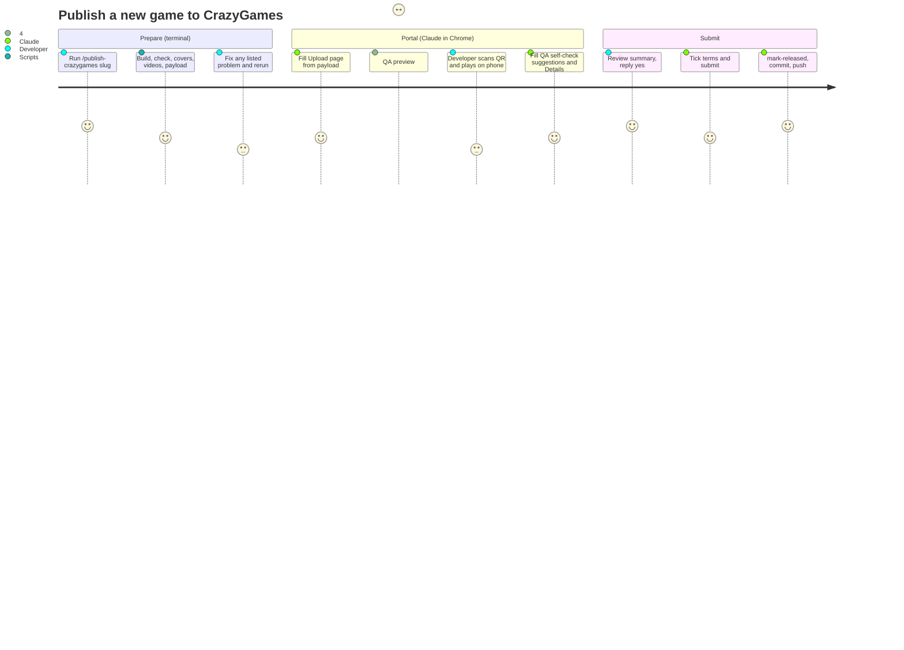

# CrazyGames Publish Automation Implementation Plan

> **For Agent:** Execute this plan task-by-task. Follow each step exactly, verify test results before proceeding, and commit after each task.
> **TDD Rule:** No production code without a failing test first.
> **First execution step:** copy this file to `docs/plans/2026-11-22-crazygames-publish-automation.md` (project convention) and track status there.

**Goal:** One command (`/publish-crazygames <slug>`) takes a finished game from repo to "submitted on CrazyGames", with Claude in Chrome doing the portal work and the user only confirming the final Submit.
**Architecture:** Three layers. (1) Node scripts in `scripts/` do everything deterministic: build, artifact checks, cover check, preview-video recording/conversion, and a JSON "publish payload" holding every form value and file path. (2) A repo skill `.claude/skills/publish-crazygames/SKILL.md` drives the portal with Claude in Chrome, reading the payload and the live page (labels, never coordinates), and stops before Submit. (3) `scripts/mark-released.ts` writes `releases.crazygames` after the user-confirmed submit.
**Tech Stack:** TypeScript (node runs `.ts` directly), vitest, Playwright (chromium, `recordVideo`), system `ffmpeg`/`ffprobe`, Claude in Chrome MCP (`file_upload`, `find`, `get_page_text`, `form_input`).
**Complexity Path:** `Simplified TDD path` for all scripts (pure functions + thin CLI shells). Portal flow is verified by one real end-to-end run on the next game (cannot be automated against CrazyGames).
**Status:** Complete (code); portal E2E pending first real run

---

## Context

Today's first CrazyGames submission of Neon Rush (dodge-drop 2.8.4) was all manual and surfaced real failure modes: a stale build left in the draft, cover PNGs dropped into the game-file zone, wrong mobile orientation, a phone recording at 720x1264 rejected by the 2:3 portrait-video check and running 21 s (> 20 s cap), no landscape video, and `game.json` release status edited by hand. Each of these is mechanical and should be caught or done by tooling so future games publish in one pass.

## Requirements

### User Stories
- As the developer, I want `/publish-crazygames <slug>` to build, check and prepare every upload asset, so that I never upload a stale or broken build.
- As the developer, I want preview videos generated automatically (or converted from my own recording), so that they always pass the 2:3 / 16:9 / ≤20 s checks.
- As the developer, I want Claude in Chrome to fill Upload, run the QA preview checks and fill Details, so that I only review and confirm.
- As the developer, I want `game.json` updated after I confirm submission, so that `npm run release-status` stays truthful.

### Acceptance Criteria
- Given a game with `store.crazygames` metadata, when `npm run publish:prep -- <slug>` runs, then it builds the portal artifact, renders/validates covers, produces both videos, writes `dist/publish/<slug>-crazygames.json`, and exits 0; any problem exits 1 listing every problem.
- Given an orientation `portrait` game, when videos are generated, then `ffprobe` reports 1080x1620 and 1920x1080, duration ≤ 20 s, h264 + yuv420p.
- Given `--from <file>`, when the user supplies their own recording, then the same two outputs are produced from that file (center-crop, optional `--top <px>` offset).
- Given `releases.crazygames` already `submitted` at the current version, when prep runs, then it refuses (nothing to resubmit).
- Given the skill reaches the Submit page, when it has filled everything, then it stops and shows a summary; it never ticks Terms/PEGI or clicks Submit without the user's explicit "yes" in chat.
- Given a confirmed submit, when `npm run mark-released -- <slug> crazygames submitted` runs, then `game.json` gets `{status, version, submittedAt}` with all other bytes unchanged.

### Assumptions, Constraints, and Scope Boundaries
- User answers (2026-11-22): video = auto-record by default, user's own recording via `--from` as fallback; SKILL.md, checklist doc, `.gitignore`/`package.json` script lines are **Configuration-only exceptions** (approved).
- Requires the user's Chrome logged in to developer.crazygames.com; cannot run headless/scheduled.
- Mobile real-device check stays manual (QR code).
- Out of scope now: GameDistribution skill (payload/video code is portal-agnostic so it can be added later), Full Launch.
- No database changes.

## Architecture Review

**Reuse (do not duplicate):**
- `scripts/build-portals.ts` `buildPortals()` → `dist/portals/crazygames/<slug>/` (upload unzipped; zone rejects zips).
- `scripts/check-artifact.ts` `checkArtifact(dir, platform)` (already called by buildPortals).
- `scripts/render-covers.ts` `renderCovers(slug)`, `COVER_SIZES`, `readPngSize()`.
- `scripts/lib/games.ts` `loadGames()`; `packages/game-kit/src/manifest.ts` `validateManifest()`.
- God mode: `window.__dd = { god: true }` set before load on the `dist/local` build (`games/dodge-drop/src/PlayScene.ts:997`, pattern in `e2e/dodge-drop.spec.ts:86-93`); `scripts/serve-static.ts` to serve `dist/local`.
- CLI shape: `if (process.argv[1] === fileURLToPath(import.meta.url))` guard; `execFileSync` with arg arrays (`scripts/build-portals.ts:53`).

**Data flow:** `game.json` (+ `store` block) → `publish:prep` → `dist/portals/crazygames/<slug>/`, `games/<slug>/store/*.png`, `dist/store/<slug>/video-*.mp4`, `dist/publish/<slug>-crazygames.json` → skill reads payload → Chrome fills portal → user confirms Submit → `mark-released` → commit + push.



**Files:**
- Modify: `packages/game-kit/src/manifest.ts`, `packages/game-kit/src/manifest.test.ts`, `games/dodge-drop/game.json`, `package.json`, `.gitignore`, `docs/specs/game-platform/checklists/crazygames.md`
- Create: `scripts/publish-payload.ts` (+ `.test.ts`), `scripts/store-video.ts` (+ `.test.ts`), `scripts/mark-released.ts` (+ `.test.ts`), `games/dodge-drop/store/record.json`, `.claude/skills/publish-crazygames/SKILL.md`

## Implementation Steps

Test command for every task: `npx vitest run <test file>`; full gate before each commit: `npm run typecheck && npm test`.

### Phase 1: Manifest `store` metadata

#### Task 1: Validate `store.crazygames`
**Goal:** Manifest accepts an optional `store` block and rejects bad category, >5 tags, bad progressSave.

**Files:** Modify `packages/game-kit/src/manifest.ts`; Test `packages/game-kit/src/manifest.test.ts`

**RED - Write Failing Test** (append)
```ts
describe('store metadata', () => {
  const store = () => ({
    controls: { en: '- Drag to move' },
    crazygames: { category: 'Arcade', tags: ['Avoid', 'Speed'], progressSave: 'sdk' },
  });
  it('accepts a valid store block', () => expect(errorsOf({ ...valid(), store: store() })).toEqual([]));
  it('is optional', () => expect(errorsOf(valid())).toEqual([]));
  it('rejects an unknown CrazyGames category', () =>
    expect(errorsOf({ ...valid(), store: { ...store(), crazygames: { ...store().crazygames, category: 'Racing' } } }))
      .toContain('store.crazygames.category must be one of the CrazyGames categories'));
  it('rejects more than 5 tags', () =>
    expect(errorsOf({ ...valid(), store: { ...store(), crazygames: { ...store().crazygames, tags: ['a', 'b', 'c', 'd', 'e', 'f'] } } }))
      .toContain('store.crazygames.tags must be 1-5 strings'));
  it('rejects unknown progressSave', () =>
    expect(errorsOf({ ...valid(), store: { ...store(), crazygames: { ...store().crazygames, progressSave: 'cloud' } } }))
      .toContain('store.crazygames.progressSave must be one of none, sdk, localstorage'));
  it('requires English controls text', () =>
    expect(errorsOf({ ...valid(), store: { ...store(), controls: { 'zh-TW': 'x' } } })).toContain('store.controls.en is required'));
});
```
**Requirements:** one behavior per `it`; real validator, no mocks.

**Verify RED - Watch It Fail**
Run: `npx vitest run packages/game-kit/src/manifest.test.ts`
Confirm: the 4 rejection tests fail (no errors returned) — feature missing, not typos. **Test passes?** You're testing existing behavior. Fix test. **Test errors?** Fix error, re-run until it fails correctly.

**GREEN - Minimal Code** (in `manifest.ts`)
```ts
export const CG_CATEGORIES = ['.io', 'Action', 'Adventure', 'Arcade', 'Beauty', 'Board', 'Card', 'Clicker', 'Driving', 'Puzzle', 'Shooting', 'Simulation', 'Sports', 'Strategy', 'Trivia', 'Word'] as const;
export const PROGRESS_SAVES = ['none', 'sdk', 'localstorage'] as const;
export interface StoreMeta {
  /** Bullet list shown in the portal "Controls" field. */
  controls: LocalizedText;
  crazygames?: { category: (typeof CG_CATEGORIES)[number]; tags: string[]; progressSave: (typeof PROGRESS_SAVES)[number] };
}
// GameManifest: add   store?: StoreMeta;

function checkStore(v: unknown, errors: string[]): void {
  if (v === undefined) return;
  if (!isObject(v)) return void errors.push('store must be an object');
  checkLocalized(v.controls, 'store.controls', errors);
  const cg = v.crazygames;
  if (cg === undefined) return;
  if (!isObject(cg)) return void errors.push('store.crazygames must be an object');
  if (!oneOf(CG_CATEGORIES, cg.category)) errors.push('store.crazygames.category must be one of the CrazyGames categories');
  if (!isStringArray(cg.tags) || cg.tags.length < 1 || cg.tags.length > 5) errors.push('store.crazygames.tags must be 1-5 strings');
  if (!oneOf(PROGRESS_SAVES, cg.progressSave)) errors.push(`store.crazygames.progressSave must be one of ${PROGRESS_SAVES.join(', ')}`);
}
// validateManifest: call checkStore(m.store, errors) after checkPortalIds
```
(Check `checkLocalized` already emits `<field>.en is required`; if its wording differs, adjust the test string to the existing wording — do not change existing messages.)

**Verify GREEN - Watch It Pass** — same command; all manifest tests pass, output pristine.
**REFACTOR** — none expected. **Verify GREEN** — `npm run typecheck && npm test`.
**COMMIT** `git commit -m "feat(game-kit): ✨ optional store metadata for portal listings"`

#### Task 2: Give dodge-drop its store metadata
**Exception Type:** Configuration-only (approved: data file)
**Files:** Modify `games/dodge-drop/game.json` — add after `"cover"`:
```json
"store": {
  "controls": { "en": "- Drag left or right with the mouse or your finger to move\n- Arrow keys or A / D to move\n- On phones, tilt control can be turned on in the game\n- Space or Enter to play again after a run" },
  "crazygames": { "category": "Arcade", "tags": ["Avoid", "Speed", "Skill", "Difficult", "2D"], "progressSave": "sdk" }
},
```
Also set `"releases.crazygames": { "status": "submitted", "version": "2.8.4", "submittedAt": "2026-11-22" }` **only if the user has confirmed the Neon Rush submit by then**; otherwise leave it.
**Verification:** `npm test` (loadGames validates every game.json). **COMMIT** `chore(dodge-drop): 🔧 CrazyGames listing metadata`

### Phase 2: Preview video

#### Task 3: Video filter graphs
**Goal:** Pure function returns the ffmpeg `-filter_complex` for both outputs from any source, for portrait and landscape games.

**Files:** Create `scripts/store-video.ts`; Test `scripts/store-video.test.ts`

**RED**
```ts
import { describe, expect, it } from 'vitest';
import { videoFilters, RECORD_VIEWPORT } from './store-video.ts';

describe('videoFilters', () => {
  it('portrait game: 2:3 centre crop scaled to 1080x1620, landscape = blurred sides', () => {
    const f = videoFilters('portrait', 0);
    expect(f.portrait).toBe("[0:v]crop='min(iw,ih*2/3)':'min(ih,iw*3/2)':(iw-ow)/2:(ih-oh)/2,scale=1080:1620:flags=lanczos,fps=60[v]");
    expect(f.landscape).toContain('scale=1920:-2,crop=1920:1080,boxblur=30:3');
    expect(f.landscape).toContain('[fg]scale=-2:1080');
    expect(f.landscape).toContain('overlay=(W-w)/2:0');
  });
  it('honours a top offset for phone recordings', () => {
    expect(videoFilters('portrait', 56).portrait).toContain(":(iw-ow)/2:'min(56,ih-oh)'");
  });
  it('landscape game: 16:9 crop for landscape, blurred top/bottom for portrait', () => {
    const f = videoFilters('landscape', 0);
    expect(f.landscape).toContain("crop='min(iw,ih*16/9)':'min(ih,iw*9/16)'");
    expect(f.landscape).toContain('scale=1920:1080');
    expect(f.portrait).toContain('overlay=0:(H-h)/2');
  });
  it('records at the target aspect so the crop is a no-op', () => {
    expect(RECORD_VIEWPORT.portrait).toEqual({ width: 720, height: 1080 });
    expect(RECORD_VIEWPORT.landscape).toEqual({ width: 1280, height: 720 });
  });
});
```
**Verify RED:** `npx vitest run scripts/store-video.test.ts` → fails: module/export missing.

**GREEN**
```ts
import type { Orientation } from '../packages/game-kit/src/manifest.ts';

export const RECORD_VIEWPORT = { portrait: { width: 720, height: 1080 }, landscape: { width: 1280, height: 720 } } as const;
const P = { w: 1080, h: 1620, a: '2/3', ia: '3/2' };
const L = { w: 1920, h: 1080, a: '16/9', ia: '9/16' };

const crop = (a: string, ia: string, top: number): string =>
  `crop='min(iw,ih*${a})':'min(ih,iw*${ia})':(iw-ow)/2:${top > 0 ? `'min(${top},ih-oh)'` : '(ih-oh)/2'}`;

export function videoFilters(orientation: Orientation, top: number): { portrait: string; landscape: string } {
  const tall = orientation !== 'landscape';
  const src = tall ? crop(P.a, P.ia, top) : crop(L.a, L.ia, top);
  const blur = 'boxblur=30:3,eq=brightness=-0.15';
  if (tall) {
    return {
      portrait: `[0:v]${src},scale=${P.w}:${P.h}:flags=lanczos,fps=60[v]`,
      landscape: `[0:v]${src},fps=60,split[a][b];[b]scale=${L.w}:-2,crop=${L.w}:${L.h},${blur}[bg];[a]scale=-2:${L.h}:flags=lanczos[fg];[bg][fg]overlay=(W-w)/2:0[v]`,
    };
  }
  return {
    landscape: `[0:v]${src},scale=${L.w}:${L.h}:flags=lanczos,fps=60[v]`,
    portrait: `[0:v]${src},fps=60,split[a][b];[b]scale=-2:${P.h},crop=${P.w}:${P.h},${blur}[bg];[a]scale=${P.w}:-2:flags=lanczos[fg];[bg][fg]overlay=0:(H-h)/2[v]`,
  };
}
```

**Verify GREEN / REFACTOR / Verify GREEN:** same command, then `npm run typecheck && npm test`.
**COMMIT** `feat(scripts): ✨ preview video filter graphs for 2:3 and 16:9`

#### Task 4: ffmpeg argument list
**Goal:** Full, deterministic ffmpeg args (trim to 19.9 s, fade out, h264/yuv420p, aac, faststart).

**RED** (append to `scripts/store-video.test.ts`)
```ts
import { ffmpegArgs, MAX_SECONDS } from './store-video.ts';
describe('ffmpegArgs', () => {
  const args = ffmpegArgs('in.webm', 'out.mp4', '[0:v]null[v]', true);
  it('trims under the 20 s cap', () => { expect(MAX_SECONDS).toBe(19.9); expect(args).toEqual(expect.arrayContaining(['-t', '19.9'])); });
  it('fades out video and audio', () => {
    expect(args[args.indexOf('-filter_complex') + 1]).toBe('[0:v]null[v];[v]fade=t=out:st=19.4:d=0.5,format=yuv420p[out]');
    expect(args).toEqual(expect.arrayContaining(['-af', 'afade=t=out:st=19.4:d=0.5', '-map', '0:a?']));
  });
  it('encodes h264 + faststart, overwrites output', () => {
    expect(args).toEqual(expect.arrayContaining(['-y', '-c:v', 'libx264', '-crf', '20', '-movflags', '+faststart']));
    expect(args.at(-1)).toBe('out.mp4');
  });
  it('omits audio flags when the source has no audio', () =>
    expect(ffmpegArgs('in.webm', 'o.mp4', '[0:v]null[v]', false)).toContain('-an'));
});
```
**Verify RED:** fails, `ffmpegArgs` not exported.

**GREEN**
```ts
export const MAX_SECONDS = 19.9;
export function ffmpegArgs(input: string, output: string, filter: string, hasAudio: boolean): string[] {
  const st = (MAX_SECONDS - 0.5).toFixed(1);
  const audio = hasAudio ? ['-map', '0:a?', '-af', `afade=t=out:st=${st}:d=0.5`, '-c:a', 'aac', '-b:a', '128k'] : ['-an'];
  return ['-v', 'error', '-y', '-i', input, '-t', String(MAX_SECONDS),
    '-filter_complex', `${filter};[v]fade=t=out:st=${st}:d=0.5,format=yuv420p[out]`, '-map', '[out]',
    ...audio, '-c:v', 'libx264', '-preset', 'slow', '-crf', '20', '-movflags', '+faststart', output];
}
```
**Verify GREEN / REFACTOR / Verify GREEN** as above. **COMMIT** `feat(scripts): ✨ ffmpeg args for portal preview videos`

#### Task 5: Output self-check
**Goal:** Parse `ffprobe -of json` output and list problems vs expected size / max duration.

**RED**
```ts
import { videoProblems } from './store-video.ts';
const probe = (w: number, h: number, d: string) => JSON.stringify({ streams: [{ codec_type: 'video', codec_name: 'h264', width: w, height: h }], format: { duration: d } });
describe('videoProblems', () => {
  it('passes a correct file', () => expect(videoProblems(probe(1080, 1620, '19.9'), 1080, 1620)).toEqual([]));
  it('flags wrong size', () => expect(videoProblems(probe(720, 1264, '19.9'), 1080, 1620)).toEqual(['size 720x1264, expected 1080x1620']));
  it('flags > 20 s', () => expect(videoProblems(probe(1080, 1620, '21.0'), 1080, 1620)).toEqual(['duration 21.0 s exceeds 20 s']));
});
```
**Verify RED:** fails, not exported.

**GREEN**
```ts
export function videoProblems(ffprobeJson: string, w: number, h: number): string[] {
  const j = JSON.parse(ffprobeJson) as { streams: Array<{ codec_type: string; width?: number; height?: number }>; format: { duration: string } };
  const v = j.streams.find((s) => s.codec_type === 'video');
  const out: string[] = [];
  if (!v || v.width !== w || v.height !== h) out.push(`size ${v?.width}x${v?.height}, expected ${w}x${h}`);
  if (Number(j.format.duration) > 20) out.push(`duration ${j.format.duration} s exceeds 20 s`);
  return out;
}
```
**COMMIT** `feat(scripts): ✨ verify generated preview videos with ffprobe`

#### Task 6: Recorder CLI (thin IO shell)
**Exception Type:** none — the shell only wires already-tested functions; verified by running it (no unit test for Playwright/ffmpeg IO, by design: keep logic out of it).
**Files:** append CLI to `scripts/store-video.ts`; Create `games/dodge-drop/store/record.json`:
```json
{ "initScript": "window.__dd = { god: true };", "warmupMs": 1500 }
```
CLI behaviour (`node scripts/store-video.ts <slug> [--from <file>] [--top <px>]`):
1. `loadGames()` → manifest; out dir `dist/store/<slug>/`.
2. No `--from`: `buildGames('local', …, {only: slug})` if `dist/local/<slug>/` missing; start `serve-static.ts dist/local 5190` via `spawn`; Playwright chromium context with `viewport = RECORD_VIEWPORT[tall?'portrait':'landscape']`, `recordVideo: { dir, size: viewport }`; `addInitScript(record.initScript)`; goto; wait `__gk.activeScenes` includes `GKTitle`; wait `warmupMs`; click canvas centre; for 21 s hold ArrowLeft/ArrowRight alternately for random 300–900 ms; close context → webm path. Kill server.
3. `ffprobe` source for audio presence; run ffmpeg twice with `ffmpegArgs(src, out, videoFilters(orientation, top)[kind], hasAudio)` → `video-portrait-1080x1620.mp4`, `video-landscape-1920x1080.mp4`.
4. `ffprobe -v error -show_streams -show_format -of json` each output → `videoProblems`; print and exit 1 if any.
Add script `"store-video": "node scripts/store-video.ts"` to `package.json`.
**Verification:** `npm run store-video -- dodge-drop` then open both MP4s (QuickLook) and extract a frame at 10 s; expect gameplay visible, no title/HUD cut. Then `npm run store-video -- dodge-drop --from "/Users/kyolai/Downloads/screen-20261122-220600-1795356256516.mp4~3.mp4" --top 56` → same outputs as today's manual result. `npm run typecheck && npm test` green.
**COMMIT** `feat(scripts): ✨ store-video records gameplay or converts a recording`

### Phase 3: Publish payload + preflight

#### Task 7: Build the CrazyGames payload
**Goal:** Pure function maps manifest + paths to every portal form value and upload path.

**Files:** Create `scripts/publish-payload.ts`; Test `scripts/publish-payload.test.ts`

**RED**
```ts
import { describe, expect, it } from 'vitest';
import { crazyGamesPayload } from './publish-payload.ts';
import type { GameManifest } from '../packages/game-kit/src/manifest.ts';

const m = (): GameManifest => ({
  slug: 'neo', version: '1.2.3', title: { en: 'Neo' }, description: { en: 'Desc' }, instructions: { en: 'Inst' },
  tags: ['arcade'], orientation: 'portrait', controls: ['mouse'], cover: 'cover.svg', targets: ['crazygames'], releases: {},
  store: { controls: { en: '- Drag' }, crazygames: { category: 'Arcade', tags: ['Avoid'], progressSave: 'sdk' } },
});

describe('crazyGamesPayload', () => {
  const p = crazyGamesPayload(m(), '/repo');
  it('maps form values', () => expect(p.form).toEqual({
    gameName: 'Neo', engine: 'HTML5', progressSave: 'Yes, using the Data Module from the CrazyGames SDK',
    supportsMobile: true, mobileOrientation: 'PORTRAIT', category: 'Arcade', tags: ['Avoid'],
    description: 'Desc', controls: '- Drag', tools: 'Phaser',
  }));
  it('points at the unzipped build and store assets', () => {
    expect(p.uploadDir).toBe('/repo/dist/portals/crazygames/neo');
    expect(p.covers).toEqual({ landscape: '/repo/games/neo/store/landscape-1920x1080.png', portrait: '/repo/games/neo/store/portrait-800x1200.png', square: '/repo/games/neo/store/square-800x800.png' });
    expect(p.videos).toEqual({ landscape: '/repo/dist/store/neo/video-landscape-1920x1080.mp4', portrait: '/repo/dist/store/neo/video-portrait-1080x1620.mp4' });
  });
  it('maps orientation any to BOTH', () => expect(crazyGamesPayload({ ...m(), orientation: 'any' }, '/r').form.mobileOrientation).toBe('BOTH'));
  it('throws without store.crazygames', () => expect(() => crazyGamesPayload({ ...m(), store: undefined }, '/r')).toThrow(/store\.crazygames/));
});
```
**Verify RED:** fails, module missing.

**GREEN**
```ts
import { join } from 'node:path';
import type { GameManifest } from '../packages/game-kit/src/manifest.ts';

const SAVE_LABEL = { none: 'No, the game does not need progress save', sdk: 'Yes, using the Data Module from the CrazyGames SDK', localstorage: 'Yes, using LocalStorage (refer to Automatic Progress Save)' } as const;
const ORIENT = { portrait: 'PORTRAIT', landscape: 'LANDSCAPE', any: 'BOTH' } as const;

export function crazyGamesPayload(g: GameManifest, root: string) {
  const cg = g.store?.crazygames;
  if (!g.store || !cg) throw new Error(`${g.slug}: add store.crazygames to game.json first`);
  const store = join(root, 'games', g.slug, 'store');
  const vids = join(root, 'dist', 'store', g.slug);
  return {
    slug: g.slug, version: g.version,
    uploadDir: join(root, 'dist', 'portals', 'crazygames', g.slug),
    form: { gameName: g.title.en, engine: 'HTML5', progressSave: SAVE_LABEL[cg.progressSave], supportsMobile: g.controls.includes('touch') || g.orientation !== 'landscape',
      mobileOrientation: ORIENT[g.orientation], category: cg.category, tags: cg.tags, description: g.description.en, controls: g.store.controls.en, tools: 'Phaser' },
    covers: { landscape: join(store, 'landscape-1920x1080.png'), portrait: join(store, 'portrait-800x1200.png'), square: join(store, 'square-800x800.png') },
    videos: { landscape: join(vids, 'video-landscape-1920x1080.mp4'), portrait: join(vids, 'video-portrait-1080x1620.mp4') },
  };
}
export type CrazyGamesPayload = ReturnType<typeof crazyGamesPayload>;
```
(`supportsMobile` with `controls: ['mouse']` + portrait = true: a portrait game is mobile-first. Add a test for `landscape` + no touch → false in REFACTOR only if you change the rule — don't add behavior.)
**COMMIT** `feat(scripts): ✨ CrazyGames publish payload from game.json`

#### Task 8: Preflight problems
**Goal:** List every blocker before touching the browser.

**RED** (append)
```ts
import { preflightProblems } from './publish-payload.ts';
describe('preflightProblems', () => {
  const p = crazyGamesPayload(m(), '/repo');
  const all = () => true;
  const size = (f: string) => (f.includes('1920x1080') ? [1920, 1080] : f.includes('800x1200') ? [800, 1200] : [800, 800]) as [number, number];
  it('passes when everything exists', () => expect(preflightProblems(p, m(), all, size)).toEqual([]));
  it('lists missing files', () => expect(preflightProblems(p, m(), (f) => !f.endsWith('.mp4'), size)).toEqual([
    `missing ${p.videos.landscape} (run npm run store-video -- neo)`, `missing ${p.videos.portrait} (run npm run store-video -- neo)`]));
  it('flags a wrong cover size', () => expect(preflightProblems(p, m(), all, () => [100, 100])).toHaveLength(3));
  it('refuses an already submitted version', () =>
    expect(preflightProblems(p, { ...m(), releases: { crazygames: { status: 'submitted', version: '1.2.3' } } }, all, size))
      .toEqual(['crazygames already submitted at 1.2.3; bump version first']));
});
```
**Verify RED:** fails, not exported.

**GREEN**
```ts
import { join } from 'node:path';
export function preflightProblems(p: CrazyGamesPayload, g: GameManifest, exists: (f: string) => boolean, pngSize: (f: string) => [number, number]): string[] {
  const out: string[] = [];
  const rel = g.releases.crazygames;
  if (rel && rel.status !== 'todo' && rel.status !== 'rejected' && rel.version === g.version) out.push(`crazygames already ${rel.status} at ${g.version}; bump version first`);
  if (!exists(join(p.uploadDir, 'index.html'))) out.push(`missing ${p.uploadDir}/index.html (run npm run build:portals)`);
  for (const [k, f] of Object.entries(p.covers)) {
    if (!exists(f)) { out.push(`missing ${f} (run npm run covers -- ${p.slug})`); continue; }
    const [w, h] = pngSize(f); const [ew, eh] = f.match(/(\d+)x(\d+)\.png$/)!.slice(1).map(Number);
    if (w !== ew || h !== eh) out.push(`${k} cover is ${w}x${h}, expected ${ew}x${eh}`);
  }
  for (const f of Object.values(p.videos)) if (!exists(f)) out.push(`missing ${f} (run npm run store-video -- ${p.slug})`);
  return out;
}
```
**COMMIT** `feat(scripts): ✨ publish preflight checks`

#### Task 9: `publish:prep` CLI (thin shell)
CLI in `scripts/publish-payload.ts`: `node scripts/publish-payload.ts <slug>` → `loadGames()` → `buildPortals` (existing CLI via `execFileSync('npm', ['run','build:portals'])`) → `renderCovers(slug)` if any cover missing → `store-video` if videos missing → `preflightProblems(…, existsSync, readPngSize-from-file)` → print problems / exit 1, else write `dist/publish/<slug>-crazygames.json` and print its path. Add `"publish:prep": "node scripts/publish-payload.ts"`.
**Verification:** `npm run publish:prep -- dodge-drop` exits 0 (after Task 2) and the JSON matches today's manual form values. `npm run typecheck && npm test`.
**COMMIT** `feat(scripts): ✨ publish:prep builds every CrazyGames upload asset`

### Phase 4: Record the release

#### Task 10: `markReleased` preserves the file
**Files:** Create `scripts/mark-released.ts`; Test `scripts/mark-released.test.ts`

**RED**
```ts
import { describe, expect, it } from 'vitest';
import { markReleased } from './mark-released.ts';
const src = '{\n  "slug": "neo",\n  "version": "1.2.3",\n  "releases": {\n    "crazygames": {\n      "status": "todo",\n      "version": "0.1.0"\n    }\n  }\n}\n';
describe('markReleased', () => {
  it('sets status, version and date, keeping 2-space JSON + newline', () =>
    expect(markReleased(src, 'crazygames', 'submitted', '2026-11-22')).toBe(
      '{\n  "slug": "neo",\n  "version": "1.2.3",\n  "releases": {\n    "crazygames": {\n      "status": "submitted",\n      "version": "1.2.3",\n      "submittedAt": "2026-11-22"\n    }\n  }\n}\n'));
  it('rejects an invalid date', () => expect(() => markReleased(src, 'crazygames', 'submitted', '22/11/2026')).toThrow(/YYYY-MM-DD/));
  it('refuses rejected without a reason', () => expect(() => markReleased(src, 'crazygames', 'rejected', '2026-11-22')).toThrow(/reason/));
});
```
**Verify RED:** fails, module missing.

**GREEN**
```ts
import type { ReleaseStatus, Target } from '../packages/game-kit/src/manifest.ts';
export function markReleased(text: string, target: Target, status: ReleaseStatus, date: string, reason?: string): string {
  if (!/^\d{4}-\d{2}-\d{2}$/.test(date)) throw new Error('date must be YYYY-MM-DD');
  if (status === 'rejected' && !reason) throw new Error('rejected needs a reason');
  const g = JSON.parse(text) as { version: string; releases: Record<string, unknown> };
  g.releases[target] = { status, version: g.version, submittedAt: date, ...(reason ? { reason } : {}) };
  return `${JSON.stringify(g, null, 2)}\n`;
}
```
Then thin CLI: `node scripts/mark-released.ts <slug> <target> <status> [--date YYYY-MM-DD] [--reason ...]` (date defaults to local today), re-validates via `validateManifest` before writing. Add `"mark-released"` script.
**Verification:** tests + `npm run mark-released -- dodge-drop crazygames submitted` on a scratch copy diff shows only the releases block.
**COMMIT** `feat(scripts): ✨ mark-released writes portal release status`

### Phase 5: Skill and docs (Configuration-only exception, approved 2026-11-22)

#### Task 11: Track the repo skill in git
**Exception Type:** Configuration-only
**Implementation:** `.gitignore`: replace `.claude/` with
```
.claude/*
!.claude/skills/
```
**Verification:** `git status --short .claude` shows only `.claude/skills/` once Task 12 exists; `settings.local.json` and `worktrees/` stay ignored.
**COMMIT** `chore: 🔧 track repo-level Claude skills`

#### Task 12: `.claude/skills/publish-crazygames/SKILL.md`
**Exception Type:** Configuration-only (approved)
**Implementation:** frontmatter `name: publish-crazygames`, `description: Use when the user wants to submit or update a game on CrazyGames (developer.crazygames.com) for a slug in games/`. Body, in order — each step lists the page, the labels to look for via `find`/`get_page_text`, the payload field to use, and the stop condition:
0. **Rules:** never use remembered coordinates; locate by label each time. Never tick "I agree to the Terms…" / PEGI or click Submit / Discard draft / Delete without the user's explicit yes in chat. If a label is missing or the page differs from this file → stop, screenshot, ask. Max 2 retries per action.
1. **Prep:** `npm run publish:prep -- <slug>`; on exit 1 show problems and stop. If the user supplies a recording, `npm run store-video -- <slug> --from <file> [--top N]`.
2. **Open:** `tabs_context_mcp` → new tab → `developer.crazygames.com/games`. If not logged in → ask user to log in. Find an existing draft named `form.gameName` → open it; else "Submit a game".
3. **Upload page:** set Game name, Game engine; if existing files differ from `uploadDir` contents → ask before "Delete all files"; upload every file under `uploadDir` with `file_upload` keeping `assets/` paths (if the zone flattens paths → stop and ask the user to drag the folder). Never upload store PNGs here. Select progress-save radio by `form.progressSave` label; mobile checkbox; orientation. Verify by reading inputs back (JS read of `input` values, as done 2026-11-22). Click "Go to QA".
4. **QA preview** (new tab/URL `crazygames.com/preview/...qaTool=true`): dismiss notification prompt ("Maybe later"); click start inside the game immediately; Log tab must show `sdkInit`, `gameLoaded`, `sdkGameLoadingStart/Stop`, `gameplayStart`; play until death → `gameplayStop`; restart → second `gameplayStart`; Warnings tab empty; Load time < 20 s; tap any rewarded button → must show "no ad" feedback and grant nothing. Any failure → stop with findings. Ask the user to scan "Show QR Code" and confirm the phone run. Never click "Continue" — tell the user to press it (it opens QA Results).
5. **QA Results:** report suggested Yes/No/N/A per row (Terms/Privacy row: N/A when the game has no accounts/personal data); the user ticks the confirm box.
6. **Details:** Category, Tags (type each, pick exact option), Description, Controls, tools; upload covers + videos via `file_upload`; leave store links and Marketing URL empty; fullscreen checkbox untouched. Click "Continue to last step".
7. **Submit:** show the summary (build version, every field, files) and ask "送出嗎？". Only on an explicit yes: tick both boxes and Submit; read back the confirmation.
8. **Record:** `npm run mark-released -- <slug> crazygames submitted`; commit `chore(<slug>): 🔖 submitted to CrazyGames v<version>`; push (batch per user memory). Close tabs the skill opened.
**Verification:** a fresh agent (haiku) reads the file back and confirms steps 0–8 exist with the Submit stop rule; real run on the next game is the acceptance test.
**COMMIT** `docs(skills): 📝 publish-crazygames browser workflow`

#### Task 13: Update the checklist
**Exception Type:** Configuration-only (docs)
**Implementation:** In `docs/specs/game-platform/checklists/crazygames.md` move "covers rendered", "description/controls entered", "orientation chosen", "upload unzipped files" into **Automated** (referencing `publish:prep` / the skill); add portrait 1080x1620 + landscape 1920x1080 ≤ 20 s video requirement (confirmed 2026-11-22); replace the manual "after submitting" edit with `npm run mark-released`. Keep ≥1 `- [ ]` item and the `UNVERIFIED` section (`scripts/checklists.test.ts`).
**Verification:** `npx vitest run scripts/checklists.test.ts`.
**COMMIT** `docs(crazygames): 📝 checklist points at publish automation`

## Testing Strategy
- Unit (vitest): manifest store validation, filter graphs, ffmpeg args, ffprobe checks, payload mapping, preflight, markReleased — all pure, no browser/ffmpeg in `npm test` (pre-push stays fast).
- Integration (manual, scripted): `npm run store-video -- dodge-drop` (auto + `--from`), `npm run publish:prep -- dodge-drop`, verified with ffprobe output pasted.
- E2E: first real run of `/publish-crazygames` on the next game (or a dodge-drop version bump); record any label drift back into SKILL.md.
- Review: code-reviewer (sonnet) over Phases 1–4 before the final push (AGENTS.md gate).

## Risks & Mitigations
- **Risk:** `file_upload` can't preserve `assets/` subfolder in the upload zone → Mitigation: Task 12 step 3 stops and asks the user to drag the folder; follow-up option: emit a flat build for CrazyGames (`assetsDir: ''`) if this recurs.
- **Risk:** Playwright `recordVideo` is low bitrate / 25 fps → Mitigation: record at target aspect, upscale with lanczos; if quality is poor, fallback is the user's own recording via `--from` (user-approved).
- **Risk:** God mode makes blocks vanish on contact, looks odd → Mitigation: random sway avoids most hits; review frame at 10 s; per-game `record.json` can change init script.
- **Risk:** CrazyGames portal UI changes → Mitigation: label-based steps, stop-and-ask on mismatch, update SKILL.md after each run.
- **Risk:** accidental submission / terms acceptance → Mitigation: hard rule in step 0 and 7; user must reply yes.

## Success Criteria
- [ ] `npm run typecheck && npm test` green; pre-push passes.
- [ ] `npm run store-video -- dodge-drop` produces 1080x1620 and 1920x1080 MP4s ≤ 20 s (ffprobe output recorded).
- [ ] `--from` reproduces today's manual conversion.
- [ ] `npm run publish:prep -- dodge-drop` exits 0 and writes the payload JSON.
- [ ] Next game reaches the Submit page via the skill with zero manual form filling except QR/phone check and final yes.
- [ ] `game.json` release updated by `mark-released`, committed and pushed.

## Execution Notes (2026-11-22)

Deviations from the tasks above, all test-first:
- Task 3 redesigned after the first real recording: dodge-drop is 720x1280 (9:16), so a 2:3 viewport letterboxed it. `videoFilters({top, bottom})` now fits the whole frame into each target over a blurred fill (orientation-agnostic, never crops HUD/player); `RECORD_VIEWPORT.portrait` is 720x1280; `record.json` may override `viewport`.
- `ffmpegArgs` gained `startAt` (skip load + title screen of the recording); `record.json` gained `afterStartScript` (dodge-drop: `window.__dd.warp(40)` to skip the slow opening).
- `mark-released` keeps the original `submittedAt` when the same version later becomes basic/full/live/rejected.
- Review done inline (user memory: no background reviewer subagents).

Verified: `npm run store-video -- dodge-drop` (auto, ~47 s) and `--from <phone recording> --top 56` both produce 1080x1620 + 1920x1080, 19.9 s, frames checked; `npm run publish:prep -- dodge-drop` refuses (2.8.4 already submitted) and the in-memory happy path returns no problems with the expected form values; `mark-released` re-run on dodge-drop is byte-identical.
Pending: first real `/publish-crazygames` run on the next game or version.
