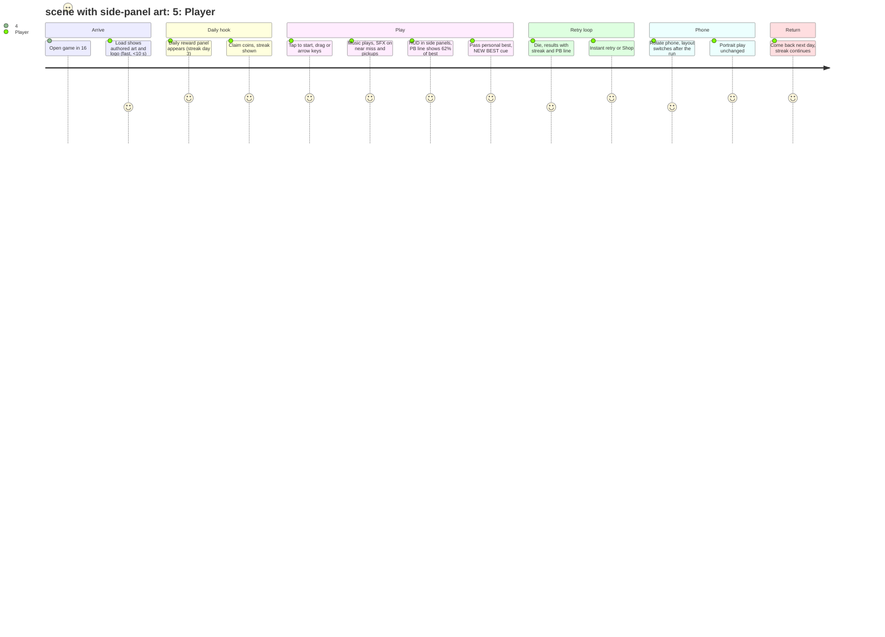

# Neon Rush (dodge-drop) v3 - CrazyGames Resubmission Implementation Plan

> **For Agent:** Execute this plan task-by-task. Follow each step exactly, verify test results before proceeding, and commit after each task.
> **TDD Rule:** No production code without a failing test first.
> **Commit trailer:** every commit message ends with the attribution line from the session system reminder (`Co-Authored-By: Claude Sonnet 5.5 <noreply@anthropic.com>`).
> **Repo rules that apply:** never review via a background reviewer subagent (reviewer = inline, see `docs/STATUS.md` landmines); pre-push hook runs `npm run typecheck && npm test && npm run test:smoke` (`docs/ci.md`); push in batches; deploy is live (GitHub Pages) so confirm the game is playable before pushing; stop before the CrazyGames Submit button (user approves).

**Goal:** Ship Neon Rush v3.0.0 with clearly visible improvements over the rejected v2.8.4 (adaptive portrait/landscape layout legible at 800x450, authored CC0 art and audio, daily reward/streak/personal-best retention) and prepare, but not submit, the CrazyGames resubmission.
**Architecture:** A pure `frame` module chooses a logical canvas per viewport (portrait 720x1280 unchanged; landscape 1440x810 with the 720-wide play field centred and HUD/missions/decoration in 360 px side panels drawn by a second camera). Retention logic is pure TypeScript persisted through the existing `SaveData` (-> `platform.storage` -> CrazyGames Data Module because `progressSave: sdk`). Art/audio are CC0 files under `games/dodge-drop/public/assets/`, loaded in the kit preload step, overriding the procedural textures/synth when present, with every file listed in a license manifest enforced by a vitest-run checker.
**Tech Stack:** Phaser 3.88, TypeScript, Vite, vitest (unit, `npm test`), Playwright (`npm run test:smoke`, `npm run test:rwd`), WebAudio, ffmpeg (already installed at `/opt/homebrew/bin/ffmpeg`).
**Complexity Path:** `E2E path` (user-facing UI, multi-layer, external portal integration, persisted state)
**Status:** Draft (awaiting user confirmation of delivery path and TDD-exception approval)

---

## Requirements

Goal in one sentence: make the resubmission a visibly different, higher-quality game than v2.8.4 along the three axes the user chose (layout, art/audio, retention), because CrazyGames FAQ says small tweaks "will most likely produce the same result".

### User Stories
- As a desktop player in a 16:9 CrazyGames iframe, I want the game to use the width of the frame with a readable HUD, so that it looks and feels made for the portal rather than a phone game with black bars.
- As a phone player in portrait, I want the existing tall play field and thumb controls unchanged, so that the game still feels right in my hand.
- As a new player, I want a coherent, bright, authored visual style with music and good sound effects, so that the first minutes feel polished (CrazyGames quality criteria: one coherent style, music complements visuals, consistent audio levels).
- As a returning player, I want a daily reward and a login streak, so that I have a reason to come back tomorrow.
- As a player mid-run, I want to see how close I am to my personal best, so that dying feels "almost there" and I retry.
- As the developer/seller of this template, I want every asset's source and license recorded and machine-checked, so that the template stays extractable and legally clean.
- As the reviewer on CrazyGames, I want the build to pass the portal technical rules (size, no external URLs, no custom fullscreen button), so that the game is not rejected for something avoidable.

### Acceptance Criteria
- Given a 16:9 iframe from 800x450 to 1920x1080, when the game loads, then the landscape layout is used, the play field and HUD fill the frame without tiny text (every HUD/label text renders at >= 14 CSS px at 800x450; side panels hold score, timer, missions, shields, personal-best line, mute button).
- Given a portrait phone viewport (for example 375x667), when the game loads, then the layout is identical to v2.8.4 (720x1280 canvas, thumb strip, HUD in the field).
- Given a window that changes orientation, when no run is in progress, then the layout switches; when a run is in progress, then the layout switches only after the run ends and the player is never moved mid-run.
- Given landscape mode at any difficulty up to 240 s, when the scheduler plans spawns, then `firstDeadEnd` returns null for all property seeds (fairness preserved with the shorter field).
- Given the title scene, when the player has not claimed today's reward, then a daily-reward panel offers the claim; claiming grants coins once per local calendar day and advances the streak.
- Given the player missed one or more whole days, when they claim, then the streak resets to day 1; given they claim on consecutive days, then the streak increments and the reward follows the 7-day table.
- Given the player has a personal best B > 0, when a run is at score S, then the HUD shows `S/B` percent and the best value, and at S > B it switches to a "NEW BEST" state exactly once per run.
- Given a CrazyGames build with progress save through the SDK, when the player reloads, then streak, last-claim day and best persist (verified in `e2e/portals.spec.ts` with the fake CrazyGames SDK).
- Given the production build, when `npm run build:portals` runs, then `scripts/check-artifact.ts` passes: total <= 10 MB, no external URLs, relative paths only.
- Given any file under `games/dodge-drop/public/assets/`, when `npm test` runs, then `scripts/check-assets.test.ts` fails unless the file has a manifest entry with license `CC0-1.0`, author, source URL, retrieval date and sha256.
- Given the final build, when `npm run publish:prep -- dodge-drop` runs, then it exits 0 with version 3.0.0, covers and videos present, and the plan stops before Submit.

### Assumptions, Constraints, and Scope Boundaries
- Scope is fixed by the user: (1) adaptive portrait+landscape layout, (2) CC0-only art/audio upgrade with manifest, (3) daily reward + streak + personal-best cue. Out of scope: new modes/worlds, onboarding rework, leaderboards, results-screen redesign beyond landscape adaptation.
- Source of the reasoning: `docs/specs/dodge-drop/crazygames-gap-analysis.md` (gaps 1, 3, 5, 6, 10 addressed here; gaps 2, 4, 7 deliberately not). The gap analysis marks root cause as inference; a rejection is not guaranteed to flip. Success is measured by the criteria below plus the user's own judgment, not by the portal.
- No database modification: persistence uses key-value `SaveData` only (new keys `daily`, `pbSeen`); no schema/DB involved. If the executor finds any DB need, STOP and ask.
- In-flight work check (`.superpowers/sdd/meta/progress.md`): 2.3 (density/shield), mobile 2.4.0, shop/daily missions 2.5.0, rotate/magnet 2.5.1, UX fixes 2.5.2, skins FX 2.6.0 are all recorded complete; `git status` shows only an unrelated `workspace-pixel-squad/run_aoa_tests.sh` change and untracked `docs/STATUS.md`. `docs/STATUS.md` ("next: 2.3, mobile") is stale (version is 2.8.4) and is refreshed in Task 0.2. Open items recorded in progress.md that overlap this plan and are FOLDED IN: "small-phone tap targets (chips/skip ~22 css px on SE)" -> Task 1.7; "results screen redesign: owner will brainstorm later" -> NOT done here (only landscape adaptation), listed as an open question. "Daily missions" already exist (rotating missions, `missions.ts`); the new daily reward is a separate login reward and must not be confused with missions in UI copy.
- Sequencing: layout (Phase 1) -> retention (Phase 2) -> art/audio (Phase 3) -> release (Phase 4). Reason: art and audio replace procedural drawing inside the same HUD/title/backdrop code that Phase 1 re-anchors; doing art first would be redone.
- Portal rules that constrain design: no custom fullscreen button on CrazyGames (`kit.ts` gates it on `platform.features`; re-verified in Task 1.6), no external links, 16:9 legibility 800x450 to 1920x1080, devicePixelRatio 1 legibility, consistent behaviour at 144/165 Hz (verify dt-based motion in Task 1.4 - existing code is dt-based, confirm only), English present.
- `docs/specs/game-platform/juice-layer.md` states "No binary assets / Non-goal: no asset pipeline". This plan intentionally supersedes that for the dodge-drop game only; Task 0.2 amends the spec so docs match reality. game-kit must keep working with zero assets (Neon Swarm and the template stay procedural-capable).
- Asset licensing: CC0 only. Candidates (UNVERIFIED from memory, must be re-verified from each pack's own page at download time; the manifest records the verification): Kenney.nl packs (all Kenney assets are published CC0; look at the UI, space/simple-shape, particle, and the Interface/Impact/Digital/Sci-fi audio packs), OpenGameArt items filtered to "CC0" for music loops, Freesound items individually marked CC0. NOT acceptable: CC-BY, CC-BY-SA, "free for commercial use" custom licenses (Pixabay/Mixkit/itch "free" without CC0), anything needing attribution. The template will be sold later, so CC0 is the safe floor.
- Size: current build is small (procedural). Budget for v3: art <= 2 MB, audio <= 4 MB (mp3, 2-3 music loops of 30-60 s at 96-128 kbps plus short SFX), total build stays well under the project cap of 10 MB (`MAX_ARTIFACT_BYTES` in `scripts/check-artifact.ts`); CrazyGames Basic Launch benchmark is load < 10 s and < 20 MB.

### Open Questions (recorded, not asked; subagent run)
1. Field height in landscape: plan uses 720x810 field (playerY 650) and tunes `speedScale` by fairness property tests. If the user prefers the exact portrait field zoomed into the centre (field only ~253 px wide at 800x450), say so; Task 1.4 would then use camera zoom and skip Task 1.2.
2. Daily reward table (coins per streak day) and whether the streak should have a one-day grace: defaults in Task 2.1 are coins [30, 40, 50, 60, 80, 100, 200] for days 1..7 and no grace. Needs the user's balance judgment (check `economy.ts` coin scale).
3. Results-screen redesign (progress.md: "owner will brainstorm later") is excluded; confirm that landscape adaptation of the existing results is enough.
4. Whether `releases.crazygames` should be reset from `rejected` to `todo` in `game.json` before `publish:prep` (see Task 4.3; script behaviour verified there).
5. Listing reuse vs new submission on the CrazyGames portal and any cooldown period are UNVERIFIED (gap analysis section (e)); check in the developer portal before the final step, do not wait on it to start work.

## Architecture Review

### Reusable components and similar implementations
- `packages/game-kit/src/save.ts` `SaveData` (`getJSON/setJSON/getNumber/setNumber`, slug-prefixed) - all new persistence goes through it (same pattern as `missions`, `medals`, `coins`).
- `packages/game-kit/src/session.ts` `GameSession.best` - source of the personal best for the PB cue (already persisted, already SDK-backed).
- `games/dodge-drop/src/missions.ts` / `progression.ts` / `economy.ts` - pure, unit-tested modules with `sanitize*` functions for untrusted saved data; new `retention.ts` copies this style.
- `games/dodge-drop/src/titleExtras.ts` + `packages/game-kit/src/titleLayout.ts` (+ `titleLayout.test.ts`) - pattern for pure layout math tested without Phaser; new `frame.ts` and `hudLayout.ts` copy it.
- `games/dodge-drop/src/layout.ts` (`PLAYER_Y`, `STRIP_*`, shared by `PlayScene.ts` and `fairness.ts`) - the single-source-of-truth pattern to extend.
- `packages/game-kit/src/audio/audio.ts` (`createGameAudio` with injectable `ctxFactory`, fake AudioContext tests in `audio.test.ts`) - extension point for sample playback.
- `games/dodge-drop/src/playArt.ts`, `skinArt.ts`, `backdrop.ts` all use `scene.textures.exists(key)` guards - a loaded PNG with the same key naturally overrides procedural generation.
- `scripts/check-artifact.ts` (size cap, URL scan over `.html/.js/.css/.json`), `scripts/publish-payload.ts` (orientation `any` -> `BOTH`), `scripts/render-covers.ts`, `scripts/store-video.ts` + `games/dodge-drop/store/record.json`.
- `e2e/rwd.spec.ts` (device sweep with `strip()` helper and `__gk` hooks), `e2e/fixtures/fake-crazygames-sdk.js`, `e2e/portals.spec.ts`.

### Affected layers and key data flow
1. Boot: `main.ts` -> `defineGame` (game-kit) now asks a `frame` provider for canvas size from `window.innerWidth/innerHeight` (+ `?layout=` override for tests) -> `Phaser.Game({width,height})`; `Kit.frame` exposes the active `Frame` to scenes.
2. Scenes read `kit.frame` instead of constants: `PlayScene` (field camera + UI camera), `TitleScene`/`titleExtras.ts`, `ShopScene`, `results.ts`, `GameOverScene`.
3. Retention: `retention.ts` (pure) <-> `SaveData` key `daily` <-> `platform.storage` (CrazyGames Data Module with `gk:` prefix). UI in `dailyPanel.ts` (title) and a streak line in `results.ts`; PB cue from `pbCue.ts` in `PlayScene` HUD.
4. Assets: `games/dodge-drop/assets/manifest.json` (NOT in `public/`, so the URL scan in `check-artifact` never sees source URLs) -> `scripts/check-assets.ts` validates against files in `games/dodge-drop/public/assets/` -> Phaser loader (`def.preload`) loads images; `GameAudio.loadSamples()` fetches/decodes audio -> `playSfx`/music prefer samples, fall back to synth.
5. Release: `game.json` (version, orientation `any`, description, `releases`) -> `npm run build:portals` -> `check-artifact` -> `npm run publish:prep`.

### Mermaid user journey


### Exact file paths that will likely change
New:
- `games/dodge-drop/src/frame.ts`, `frame.test.ts`
- `games/dodge-drop/src/hudLayout.ts`, `hudLayout.test.ts`
- `games/dodge-drop/src/retention.ts`, `retention.test.ts`
- `games/dodge-drop/src/pbCue.ts`, `pbCue.test.ts`
- `games/dodge-drop/src/dailyPanel.ts`
- `games/dodge-drop/src/art.ts` (asset key map + preload), `art.test.ts`
- `packages/game-kit/src/audio/samples.ts`, `samples.test.ts`
- `scripts/check-assets.ts`, `scripts/check-assets.test.ts`
- `games/dodge-drop/assets/manifest.json`, `games/dodge-drop/assets/README.md`
- `games/dodge-drop/public/assets/**` (images, audio)
- `e2e/crazygames-viewport.spec.ts`
- `docs/specs/dodge-drop/v3-resubmit-notes.md` (changelog + portal notes, Phase 4)

Modified:
- `games/dodge-drop/src/main.ts`, `layout.ts`, `fairness.ts`, `schedule.ts`, `PlayScene.ts`, `titleExtras.ts`, `ShopScene.ts`, `results.ts`, `backdrop.ts`, `playArt.ts`, `skinArt.ts`, `strings.ts`, `strings.test.ts`
- `packages/game-kit/src/defineGame.ts`, `kit.ts`, `scenes/PreloadScene.ts`, `scenes/TitleScene.ts`, `scenes/GameOverScene.ts`, `titleLayout.ts`, `audio/audio.ts`, `audio/sfx.ts`, `index.ts`, `manifest.ts` only if needed
- `games/dodge-drop/game.json` (version 3.0.0, orientation `any`, description, instructions, `releases`)
- `e2e/dodge-drop.spec.ts`, `e2e/smoke.spec.ts`, `e2e/results.spec.ts`, `e2e/dodge-drop-mobile.spec.ts`, `e2e/rwd.spec.ts`, `e2e/portals.spec.ts` (portrait pin via `?layout=portrait`; landscape additions)
- `package.json` (`check:assets` script), `docs/STATUS.md`, `docs/specs/game-platform/juice-layer.md`, `docs/specs/game-platform/checklists/crazygames.md`
- `games/dodge-drop/store/*.png`, `store/record.json` (regenerated)

## TDD Exception Candidates (needs user approval)

Per the plan skill, throwaway/generated/configuration-only work must not get fake RED/GREEN steps; it needs explicit approval first. Candidate tasks: **1.8 (config: manifest orientation), 3.2 (asset sourcing: art), 3.3 (asset sourcing: music/SFX), 3.9 (generated: audio normalisation output), 4.2 (config: version/description bump), 4.3 (generated: covers/videos)**. Every behavioural consequence of those files IS test-first elsewhere (manifest checker in 3.1, texture override in 3.4, audio engine in 3.6, build checks in 4.1).

**Proposed exception contract (NEEDS USER APPROVAL - not yet approved, so those tasks below are written in the exception format but are blocked until the user approves):** For Configuration-only, Generated and asset-only tasks, the executor replaces RED/GREEN with: (a) the exact change, (b) a machine verification command that fails before the change and passes after, where one exists (the checker from Task 3.1 gives asset tasks a real failing-first gate), (c) `npm run typecheck && npm test` stays green, (d) commit. If the user declines the exception, the executor must instead add a test per task (for example a vitest that reads `game.json` and asserts version/orientation) - sketched inline for 1.8 and 4.2 as "fallback if exception declined".

## Implementation Steps

### Phase 0: Baseline and housekeeping

#### Task 0.1: Viewport baseline spec (captures the "before" and guards later work)
**Goal:** Prove, in an automated spec, what v2.8.4 does at CrazyGames iframe sizes, so Phase 1 has a failing test and a before screenshot set.

**Files:**
- Create: `e2e/crazygames-viewport.spec.ts`
- Modify: `games/dodge-drop/src/main.ts` (none yet), `packages/game-kit/src/defineGame.ts` (test hook `frame`, added in Task 1.3 - this task only asserts it exists, so it fails)
- Test: `e2e/crazygames-viewport.spec.ts`

**RED - Write Failing Test**
```ts
// e2e/crazygames-viewport.spec.ts
// CrazyGames requires legibility in 16:9 iframes from 800x450 to 1920x1080 and on phones.
import { expect, test, type Page } from '@playwright/test';

const GAME = 'http://localhost:5180/dodge-drop/';
const OUT = '.superpowers/sdd/meta/v3';

type GK = { frame?: { mode: 'portrait' | 'landscape'; width: number; height: number; fieldX: number; fieldW: number }; activeScenes: string[] };
type DDHud = { name: string; x: number; y: number; fontPx: number }[];

async function ready(page: Page): Promise<void> {
  await page.waitForFunction(() => (window as unknown as { __gk?: GK }).__gk?.activeScenes.includes('GKTitle'));
}

const SIZES = [
  { name: '800x450', width: 800, height: 450 },
  { name: '907x510', width: 907, height: 510 },
  { name: '1920x1080', width: 1920, height: 1080 },
] as const;

for (const s of SIZES) {
  test(`landscape frame at ${s.name}`, async ({ page }) => {
    await page.setViewportSize({ width: s.width, height: s.height });
    await page.goto(GAME);
    await ready(page);
    const frame = await page.evaluate(() => (window as unknown as { __gk: GK }).__gk.frame);
    expect(frame?.mode).toBe('landscape');
    const box = (await page.locator('canvas').boundingBox())!;
    expect(Math.abs(box.width / box.height - 16 / 9)).toBeLessThan(0.02);
    await page.screenshot({ path: `${OUT}/title-${s.name}.png` });
  });
}

test('portrait frame on a phone-sized viewport is unchanged', async ({ page }) => {
  await page.setViewportSize({ width: 375, height: 667 });
  await page.goto(GAME);
  await ready(page);
  const frame = await page.evaluate(() => (window as unknown as { __gk: GK }).__gk.frame);
  expect(frame).toMatchObject({ mode: 'portrait', width: 720, height: 1280, fieldX: 0, fieldW: 720 });
});

test('?layout=portrait forces the portrait frame even on a wide window', async ({ page }) => {
  await page.setViewportSize({ width: 1280, height: 720 });
  await page.goto(`${GAME}?layout=portrait`);
  await ready(page);
  const frame = await page.evaluate(() => (window as unknown as { __gk: GK }).__gk.frame);
  expect(frame?.mode).toBe('portrait');
});

test('landscape HUD text is legible at 800x450 and sits outside the play field', async ({ page }) => {
  await page.setViewportSize({ width: 800, height: 450 });
  await page.goto(GAME);
  await ready(page);
  await page.mouse.click(400, 225); // start (tap anywhere on title)
  await page.waitForFunction(() => (window as unknown as { __gk: GK }).__gk.activeScenes.includes('Play'));
  const { hud, frame, scale } = await page.evaluate(() => {
    const w = window as unknown as { __gk: GK; __dd: { hud(): DDHud } };
    const c = document.querySelector('canvas')!.getBoundingClientRect();
    return { hud: w.__dd.hud(), frame: w.__gk.frame!, scale: c.width / w.__gk.frame!.width };
  });
  for (const h of hud) {
    expect(h.fontPx * scale, `${h.name} font in CSS px`).toBeGreaterThanOrEqual(14);
    const insideField = h.x >= frame.fieldX && h.x <= frame.fieldX + frame.fieldW;
    expect(insideField, `${h.name} must be in a side panel`).toBe(false);
  }
  await page.screenshot({ path: `${OUT}/play-800x450.png` });
});
```
Note: the scene key `Play` is the key used by `Kit.playKey` for `PlayScene`; confirm with `grep -n "super(" games/dodge-drop/src/PlayScene.ts` before running and adjust the string if it differs.

**Requirements:**
- One behaviour per test; Playwright config already serves the game on :5180 (see `playwright.config.ts` and how `e2e/smoke.spec.ts` is served by `npm run build:local`).
- Screenshots go to `.superpowers/sdd/meta/v3/` (docs-only path for the pre-push hook).

**Verify RED - Watch It Fail**
Run: `npm run build:local && npx playwright test e2e/crazygames-viewport.spec.ts`

Confirm:
- Every test fails because `__gk.frame` is undefined (feature missing), not because of a selector typo or server error.
- The "before" screenshots exist in `.superpowers/sdd/meta/v3/` (title-800x450.png shows the thin portrait strip - this is the evidence for the PR/notes).

**Test passes?** You're testing existing behavior. Fix test.

**Test errors?** Fix error (port, scene key), re-run until it fails correctly.

**GREEN - Minimal Code**
No production code in this task. It is a deliberately red spec that Tasks 1.3-1.6 turn green. Mark the tests with `test.fail` ONLY if the pre-push hook would otherwise block the intermediate commits: set `test.describe.configure({ mode: 'serial' })` is NOT needed; instead keep the spec out of the smoke list until Task 1.6 (it is not in the `test:smoke` file list, so the hook is unaffected). Commit the red spec as-is.

**Verify GREEN - Watch It Pass**
Run: `npm run typecheck`

Confirm:
- Typecheck passes (spec compiles). Playwright spec stays red until Task 1.6 by design.

**REFACTOR - Clean Up**
- Share the `ready()`/`frame()` helpers later via `e2e/fixtures/` if a second spec needs them (do not do it now, YAGNI).

**Verify GREEN - Stay Green After Refactor**
Run: `npm run typecheck && npm test`

Confirm:
- Both pass; output pristine.

**COMMIT**
Run:
`git add e2e/crazygames-viewport.spec.ts && git commit -m "test(dodge-drop): 🧪 add CrazyGames iframe viewport spec (red baseline)"`

#### Task 0.2: Refresh stale docs (doc-only, Trivial tier)
**Goal:** Make `docs/STATUS.md`, the juice-layer spec and the CrazyGames checklist match reality before work starts.

**Files:**
- Modify: `docs/STATUS.md`, `docs/specs/game-platform/juice-layer.md`, `docs/specs/game-platform/checklists/crazygames.md`

**Implementation (no behaviour change, diff < 20 lines; exempt from RED/GREEN under the Trivial gate in AGENTS.md, re-read the diff once):**
- `docs/STATUS.md`: update `updated:` to 2026-11-23; replace the stale "dodge-drop 2.2+ / next 2.3" lines with "v2.8.4 rejected by CrazyGames 2026-11-23; v3 resubmission plan: `docs/plans/2026-11-23-dodge-drop-v3-crazygames-resubmit.md`".
- `juice-layer.md`: under "Non-goals" append "Superseded for dodge-drop v3 (2026-11): optional CC0 image/audio assets are allowed; game-kit still works with none. See plan 2026-11-23."
- `crazygames.md`: add the unchecked item "Rejection history: v2.8.4 rejected 2026-11-23 ('overall quality'); resubmission needs clear improvements (FAQ)".

**Verification**
Run: `git diff --stat docs/`

Confirm:
- Only the three files, < 20 added lines, no code touched.

**COMMIT**
Run:
`git commit -am "docs: 📝 refresh status and specs for v3 resubmission"`

### Phase 1: Adaptive portrait + landscape layout

Design recap: portrait frame = today's 720x1280. Landscape frame = 1440x810 canvas, play field 720x810 at `fieldX = 360`, `playerY = 650`, side panels 360 px wide each. All field objects keep field-local coordinates 0..720 (a main camera viewport of x=360,w=720 maps them), so the 1171-line `PlayScene.ts` keeps its `W = 720` maths; HUD/panel objects live in canvas coordinates on a second camera. Shake/hit-stop act on the field camera only (HUD stays steady - an improvement in readability).

#### Task 1.1: Pure frame model
**Goal:** One tested function decides mode and geometry from the viewport.

**Files:**
- Create: `games/dodge-drop/src/frame.ts`
- Test: `games/dodge-drop/src/frame.test.ts`

**RED - Write Failing Test**
```ts
// games/dodge-drop/src/frame.test.ts
import { describe, expect, it } from 'vitest';
import { FIELD_W, frameFor, parseLayoutOverride, pickMode } from './frame.ts';

describe('pickMode', () => {
  it('uses landscape for 16:9 iframes at every CrazyGames size', () => {
    for (const [w, h] of [[800, 450], [907, 510], [1280, 720], [1920, 1080]] as const) {
      expect(pickMode(w, h)).toBe('landscape');
    }
  });
  it('uses portrait for phones in portrait and for squarish windows', () => {
    for (const [w, h] of [[375, 667], [390, 844], [768, 1024], [900, 900]] as const) {
      expect(pickMode(w, h)).toBe('portrait');
    }
  });
  it('honours an explicit override', () => {
    expect(pickMode(1920, 1080, 'portrait')).toBe('portrait');
    expect(pickMode(375, 667, 'landscape')).toBe('landscape');
  });
  it('guards zero/invalid sizes by falling back to portrait', () => {
    expect(pickMode(0, 0)).toBe('portrait');
    expect(pickMode(Number.NaN, 100)).toBe('portrait');
  });
});

describe('frameFor', () => {
  it('portrait matches the v2.8.4 constants exactly', () => {
    expect(frameFor('portrait')).toEqual({
      mode: 'portrait', width: 720, height: 1280, fieldX: 0, fieldW: 720, fieldH: 1280,
      playerY: 1000, stripTop: 1060, stripBottom: 1280, speedScale: 1,
    });
  });
  it('landscape centres a 720-wide field with equal side panels', () => {
    const f = frameFor('landscape');
    expect(f.width).toBe(1440);
    expect(f.height).toBe(810);
    expect(f.fieldW).toBe(FIELD_W);
    expect(f.fieldX * 2 + f.fieldW).toBe(f.width);
    expect(f.playerY).toBeLessThan(f.fieldH);
    expect(f.stripTop).toBe(f.stripBottom); // no thumb strip in landscape
  });
  it('landscape aspect is 16:9', () => {
    const f = frameFor('landscape');
    expect(f.width / f.height).toBeCloseTo(16 / 9, 5);
  });
});

describe('parseLayoutOverride', () => {
  it('reads ?layout=', () => {
    expect(parseLayoutOverride('?layout=portrait')).toBe('portrait');
    expect(parseLayoutOverride('?a=1&layout=landscape')).toBe('landscape');
    expect(parseLayoutOverride('?layout=weird')).toBeUndefined();
    expect(parseLayoutOverride('')).toBeUndefined();
  });
});
```

**Requirements:**
- One behaviour per `it`; no mocks.

**Verify RED - Watch It Fail**
Run: `npx vitest run games/dodge-drop/src/frame.test.ts`

Confirm:
- Fails with "Failed to resolve import ./frame.ts" (module missing), not a syntax error.

**Test passes?** You're testing existing behavior. Fix test.

**Test errors?** Fix error, re-run until it fails correctly.

**GREEN - Minimal Code**
```ts
// games/dodge-drop/src/frame.ts
/** Pure viewport -> logical frame model. Field-local coordinates are always 0..FIELD_W. */
export const FIELD_W = 720;
export type FrameMode = 'portrait' | 'landscape';

export interface Frame {
  mode: FrameMode;
  /** Logical canvas size. */
  width: number;
  height: number;
  /** Play-field rectangle inside the canvas (field-local x 0 maps to canvas fieldX). */
  fieldX: number;
  fieldW: number;
  fieldH: number;
  playerY: number;
  stripTop: number;
  stripBottom: number;
  /** Multiplier on block fall speed; tuned in Task 1.2 so the fairness property holds. */
  speedScale: number;
}

/** Windows wider than this (w/h) get the landscape frame. */
export const LANDSCAPE_MIN_RATIO = 1.15;

const PORTRAIT: Frame = {
  mode: 'portrait', width: 720, height: 1280, fieldX: 0, fieldW: FIELD_W, fieldH: 1280,
  playerY: 1000, stripTop: 1060, stripBottom: 1280, speedScale: 1,
};
const LANDSCAPE: Frame = {
  mode: 'landscape', width: 1440, height: 810, fieldX: 360, fieldW: FIELD_W, fieldH: 810,
  playerY: 650, stripTop: 810, stripBottom: 810, speedScale: 1,
};

export function pickMode(viewW: number, viewH: number, override?: FrameMode): FrameMode {
  if (override) return override;
  if (!Number.isFinite(viewW) || !Number.isFinite(viewH) || viewW <= 0 || viewH <= 0) return 'portrait';
  return viewW / viewH >= LANDSCAPE_MIN_RATIO ? 'landscape' : 'portrait';
}

export function frameFor(mode: FrameMode): Frame {
  return { ...(mode === 'landscape' ? LANDSCAPE : PORTRAIT) };
}

export function parseLayoutOverride(search: string): FrameMode | undefined {
  const v = new URLSearchParams(search).get('layout');
  return v === 'portrait' || v === 'landscape' ? v : undefined;
}
```

**Verify GREEN - Watch It Pass**
Run: `npx vitest run games/dodge-drop/src/frame.test.ts`

Confirm:
- All tests pass; other tests still pass; output pristine.

**REFACTOR - Clean Up**
- Make `layout.ts` derive its legacy exports from `frameFor('portrait')` (`PLAYER_Y`, `STRIP_TOP`, `STRIP_BOTTOM` stay exported with unchanged values to keep imports valid).

**Verify GREEN - Stay Green After Refactor**
Run: `npx vitest run games/dodge-drop && npm run typecheck`

Confirm:
- Existing `layout.test.ts` still passes; output pristine.

**COMMIT**
Run:
`git add games/dodge-drop/src/frame.ts games/dodge-drop/src/frame.test.ts games/dodge-drop/src/layout.ts && git commit -m "feat(dodge-drop): ✨ pure portrait/landscape frame model"`

#### Task 1.2: Fairness and scheduler take the frame's player row and speed scale (highest-risk task)
**Goal:** Prove spawn planning stays survivable in landscape (`playerY` 650, shorter look-ahead), tuning `speedScale`.

**Files:**
- Modify: `games/dodge-drop/src/fairness.ts` (add `playerY` to `FieldOptions`, use it in the two `PLAYER_Y` comparisons around lines 74 and 82), `games/dodge-drop/src/schedule.ts` (add `playerY` to `DifficultyOptions`, pass to `firstDeadEnd`, use in `hitAt` at line 96), `games/dodge-drop/src/frame.ts` (final `speedScale`)
- Test: `games/dodge-drop/src/schedule.test.ts`

**RED - Write Failing Test**
Add to `games/dodge-drop/src/schedule.test.ts` (reuse its `badSeeds` helper; extend `Opts` with `playerY?: number` and forward it to both `SpawnScheduler` opts and the `firstDeadEnd` options):
```ts
import { frameFor } from './frame.ts';

describe('SpawnScheduler in the landscape frame', () => {
  const land = frameFor('landscape');
  const opts = { speedMul: land.speedScale, playerY: land.playerY };

  it('leaves a survivable path for every seed up to 240 s with the landscape player row', async () => {
    expect(await badSeeds(SEEDS, opts, 240)).toEqual([]);
  }, 300_000);

  it('portrait default (no playerY) behaves exactly as before', async () => {
    expect(await badSeeds(SEEDS.slice(0, 20), {}, 60)).toEqual([]);
  }, 120_000);
});
```
Update the `Opts` type and `badSeeds` body accordingly:
```ts
type Opts = { speedMul?: number; intervalMul?: number; startT?: number; playerY?: number };
// inside badSeeds:
if (firstDeadEnd(all, W, fromT, toT, { speedMul: opts.speedMul ?? 1, playerY: opts.playerY }) !== null) bad.push(seed);
```

**Requirements:**
- One behaviour; real scheduler, no mocks.

**Verify RED - Watch It Fail**
Run: `PROPERTY_SEEDS=100 npx vitest run games/dodge-drop/src/schedule.test.ts`

Confirm:
- Typecheck-level failure is not enough: vitest does not typecheck, so `playerY` is silently ignored and the landscape test would pass for the WRONG reason. To make RED real, add one extra assertion that proves the option is wired: `expect(firstDeadEnd(fixedSpawns, W, 0, 20, { playerY: 400 })).not.toEqual(firstDeadEnd(fixedSpawns, W, 0, 20, { playerY: 1000 }))` using a hand-built `fixedSpawns` array (take one failing seed's unvalidated plan from `new SpawnScheduler(mulberry32(1), W, false).planUntil(20)`). This fails now (option ignored -> equal).
- Failure message shows the two results equal.

**Test passes?** You're testing existing behavior. Fix test.

**Test errors?** Fix error, re-run until it fails correctly.

**GREEN - Minimal Code**
```ts
// fairness.ts
export interface FieldOptions {
  speedMul?: number;
  /** Player row in field px (default: portrait PLAYER_Y). */
  playerY?: number;
}
// in firstDeadEnd, near the top:
const py = opts?.playerY ?? PLAYER_Y;
// replace the two PLAYER_Y uses in the band search with py:
//   if (yAt(m) > py - reach) b = m;
//   if (yAt(m) >= py + reach) b = m;

// schedule.ts
export interface DifficultyOptions {
  speedMul?: number;
  intervalMul?: number;
  startT?: number;
  playerY?: number;
}
// in the validation call:
const dead = (): number | null => firstDeadEnd([...history, ...this.buffer], this.width, fromT, toT, {
  speedMul: this.opts.speedMul ?? 1,
  playerY: this.opts.playerY,
});
// in hitAt:
const hitAt = (e: Entry): number => e.at + ((this.opts.playerY ?? PLAYER_Y) - SPAWN_Y) / (speed * e.speedMul);
```
Then run the landscape property test. If it fails (some seeds dead-end because look-ahead is 35% shorter at top speed), lower `LANDSCAPE.speedScale` in `frame.ts` in steps of 0.05 (start 0.9, then 0.85, 0.8) until `badSeeds` is empty at `PROPERTY_SEEDS=300`; keep the largest passing value. Also run the unvalidated-control test (already present) to confirm the property is meaningful.

**Verify GREEN - Watch It Pass**
Run: `PROPERTY_SEEDS=300 npx vitest run games/dodge-drop/src/schedule.test.ts games/dodge-drop/src/fairness.test.ts`

Confirm:
- Landscape and portrait property tests pass; existing fairness tests pass; output pristine; runtime within the existing 300 s timeouts (CI uses 100 seeds: also run once with `PROPERTY_SEEDS=100`).

**REFACTOR - Clean Up**
- Remove duplicated `?? PLAYER_Y` by a tiny local `const py = ...` in schedule.ts; document the chosen `speedScale` with a one-line comment citing this test.

**Verify GREEN - Stay Green After Refactor**
Run: `PROPERTY_SEEDS=100 npm test && npm run typecheck`

Confirm:
- Whole suite green; output pristine.

**COMMIT**
Run:
`git add games/dodge-drop/src && git commit -m "feat(dodge-drop): ✨ fairness and scheduler honour the frame player row"`

#### Task 1.3: defineGame picks the frame, Kit exposes it, test hook
**Goal:** Boot with the right canvas size per viewport, expose `kit.frame` and `__gk.frame`.

**Files:**
- Modify: `packages/game-kit/src/defineGame.ts` (new optional `frame` provider), `packages/game-kit/src/kit.ts` (`frame` field + `applyFrame`), `games/dodge-drop/src/main.ts`
- Create: `packages/game-kit/src/frameProvider.ts`
- Test: `packages/game-kit/src/frameProvider.test.ts`, `e2e/crazygames-viewport.spec.ts` (from Task 0.1 first two tests)

**RED - Write Failing Test**
```ts
// packages/game-kit/src/frameProvider.test.ts
import { describe, expect, it } from 'vitest';
import { resolveCanvasSize } from './frameProvider.ts';

const frames = (w: number, h: number) => ({ width: w, height: h });

describe('resolveCanvasSize', () => {
  it('falls back to the static size when no provider is given', () => {
    expect(resolveCanvasSize(undefined, { width: 720, height: 1280 }, 1920, 1080)).toEqual({ width: 720, height: 1280 });
  });
  it('asks the provider with the viewport', () => {
    const seen: number[] = [];
    const out = resolveCanvasSize((vw, vh) => { seen.push(vw, vh); return frames(1440, 810); }, { width: 720, height: 1280 }, 1920, 1080);
    expect(seen).toEqual([1920, 1080]);
    expect(out).toEqual({ width: 1440, height: 810 });
  });
  it('ignores a provider that returns nonsense', () => {
    expect(resolveCanvasSize(() => frames(0, -1), { width: 720, height: 1280 }, 100, 100)).toEqual({ width: 720, height: 1280 });
  });
});
```

**Requirements:**
- Pure function only unit-tested here; the Playwright tests from 0.1 cover wiring.

**Verify RED - Watch It Fail**
Run: `npx vitest run packages/game-kit/src/frameProvider.test.ts`

Confirm:
- Fails with unresolved import `./frameProvider.ts`.

**Test passes?** You're testing existing behavior. Fix test.

**Test errors?** Fix error, re-run until it fails correctly.

**GREEN - Minimal Code**
```ts
// packages/game-kit/src/frameProvider.ts
export interface CanvasSize { width: number; height: number }
export type CanvasSizeProvider = (viewW: number, viewH: number) => CanvasSize;

export function resolveCanvasSize(provider: CanvasSizeProvider | undefined, fallback: CanvasSize, viewW: number, viewH: number): CanvasSize {
  if (!provider) return fallback;
  const s = provider(viewW, viewH);
  return Number.isFinite(s.width) && Number.isFinite(s.height) && s.width > 0 && s.height > 0 ? s : fallback;
}
```
In `defineGame.ts`: add `canvasSize?: CanvasSizeProvider; frame?: () => unknown` to `GameDefinition`; before `new Phaser.Game` compute `const size = resolveCanvasSize(def.canvasSize, { width: def.width, height: def.height }, window.innerWidth, window.innerHeight)` and use `size.width/size.height`. Add `get frame() { return kit.game.registry.get('gk:frame'); }` to the `__gk` test-hook object. In `kit.ts` add `setFrame(f: unknown)` storing it in `game.registry` key `gk:frame` and a typed generic `frame<T>()` getter. In `main.ts`:
```ts
import { frameFor, parseLayoutOverride, pickMode } from './frame.ts';
const override = typeof location === 'undefined' ? undefined : parseLayoutOverride(location.search);
...
void defineGame({
  ...,
  width: 720, height: 1280, // static fallback
  canvasSize: (vw, vh) => { const f = frameFor(pickMode(vw, vh, override)); return { width: f.width, height: f.height }; },
  onFrame: (vw, vh) => frameFor(pickMode(vw, vh, override)),
});
```
(`onFrame` result is stored into the registry by `defineGame` as `gk:frame` so `kit.frame` works; keep `frame?` typed as `unknown` in game-kit so it stays game-agnostic, with a thin typed accessor in `games/dodge-drop/src/frameAccess.ts`: `export const getFrame = (scene: Phaser.Scene): Frame => scene.registry.get('gk:frame') as Frame;`.)
Also in `index.ts` export `resolveCanvasSize`.

**Verify GREEN - Watch It Pass**
Run: `npx vitest run packages/game-kit && npm run typecheck && npm run build:local && npx playwright test e2e/crazygames-viewport.spec.ts -g "landscape frame|portrait frame|layout=portrait"`

Confirm:
- Unit tests pass; the three frame-mode e2e tests pass (aspect and `__gk.frame`); the HUD legibility test is still red (Task 1.4/1.5). Output pristine.

**REFACTOR - Clean Up**
- Remove duplicate window-size reads; make `main.ts` override parsing a single const.

**Verify GREEN - Stay Green After Refactor**
Run: `npm run typecheck && npm test`

Confirm:
- Green; output pristine.

**COMMIT**
Run:
`git add packages/game-kit games/dodge-drop/src && git commit -m "feat(game-kit): ✨ viewport-driven canvas size and frame registry hook"`

#### Task 1.4: PlayScene field camera, UI camera, HUD in side panels
**Goal:** In landscape, the field renders in the centre 720 px, HUD/missions/shields/mute live in side panels at readable size; portrait is pixel-identical to before.

**Files:**
- Create: `games/dodge-drop/src/hudLayout.ts`, `games/dodge-drop/src/hudLayout.test.ts`
- Modify: `games/dodge-drop/src/PlayScene.ts` (`W`/`H` constants at lines 26-27 become frame-derived `this.fieldW/fieldH`; `buildHud` at line 408; `buildStrip` at 393; `PLAYER_Y` uses at lines 359-361, 860-913, 953-982, 1086, 1122; every `fallSpeed(this.t) * speedBoost(this.t)` site at lines 506, 645, 802, 852, 887 becomes `this.baseSpeed()` which multiplies by `frame.speedScale`; `H` uses at 330, 514-520, 525, 786-787, 806, 878, 906), `games/dodge-drop/src/backdrop.ts`
- Test: `games/dodge-drop/src/hudLayout.test.ts`, `e2e/crazygames-viewport.spec.ts` (HUD legibility test)

**RED - Write Failing Test**
```ts
// games/dodge-drop/src/hudLayout.test.ts
import { describe, expect, it } from 'vitest';
import { frameFor } from './frame.ts';
import { hudAnchors, MIN_HUD_FONT } from './hudLayout.ts';

describe('hudAnchors', () => {
  it('portrait keeps the v2.8.4 anchors', () => {
    const a = hudAnchors(frameFor('portrait'));
    expect(a.score).toEqual({ x: 24, y: 18, originX: 0, panel: false });
    expect(a.timer.originX).toBe(1);
    expect(a.mute).toEqual({ x: 672, y: 48 });
  });
  it('landscape puts every HUD anchor outside the field rectangle', () => {
    const f = frameFor('landscape');
    const a = hudAnchors(f);
    for (const [name, p] of Object.entries({ score: a.score, combo: a.combo, timer: a.timer, shields: a.shields, best: a.best, mute: a.mute, missions: a.missions })) {
      const inside = p.x >= f.fieldX && p.x <= f.fieldX + f.fieldW;
      expect(inside, `${name} x=${p.x}`).toBe(false);
    }
  });
  it('landscape HUD fonts stay legible after 800x450 scaling (0.556)', () => {
    const a = hudAnchors(frameFor('landscape'));
    expect(a.fontScale * MIN_HUD_FONT * (450 / 810)).toBeGreaterThanOrEqual(14);
  });
  it('landscape panels are symmetric: left holds score/combo/PB, right holds timer/shields/missions/mute', () => {
    const f = frameFor('landscape');
    const a = hudAnchors(f);
    expect(a.score.x).toBeLessThan(f.fieldX);
    expect(a.best.x).toBeLessThan(f.fieldX);
    expect(a.timer.x).toBeGreaterThan(f.fieldX + f.fieldW);
    expect(a.mute.x).toBeGreaterThan(f.fieldX + f.fieldW);
  });
});
```

**Requirements:**
- Pure anchors computed once; PlayScene only consumes them.

**Verify RED - Watch It Fail**
Run: `npx vitest run games/dodge-drop/src/hudLayout.test.ts`

Confirm:
- Fails with unresolved import `./hudLayout.ts`.

**Test passes?** You're testing existing behavior. Fix test.

**Test errors?** Fix error, re-run until it fails correctly.

**GREEN - Minimal Code**
```ts
// games/dodge-drop/src/hudLayout.ts
import type { Frame } from './frame.ts';

export const MIN_HUD_FONT = 40; // game px; 40 * 450/810 = 22 css px at 800x450

export interface Anchor { x: number; y: number; originX?: number; panel?: boolean }
export interface HudAnchors {
  score: Anchor; combo: Anchor; timer: Anchor; shields: Anchor; best: Anchor; missions: Anchor;
  mute: { x: number; y: number };
  fontScale: number;
}

export function hudAnchors(f: Frame): HudAnchors {
  if (f.mode === 'portrait') {
    return {
      score: { x: 24, y: 18, originX: 0, panel: false },
      combo: { x: 24, y: 76, originX: 0, panel: false },
      timer: { x: f.width - 100, y: 24, originX: 1, panel: false },
      shields: { x: 220, y: 44, originX: 0, panel: false },
      best: { x: 24, y: 120, originX: 0, panel: false },
      missions: { x: f.width / 2, y: 120, originX: 0.5, panel: false },
      mute: { x: f.width - 48, y: 48 },
      fontScale: 1,
    };
  }
  const left = 24;
  const right = f.width - 24;
  return {
    score: { x: left, y: 40, originX: 0, panel: true },
    combo: { x: left, y: 120, originX: 0, panel: true },
    best: { x: left, y: 210, originX: 0, panel: true },
    timer: { x: right, y: 40, originX: 1, panel: true },
    shields: { x: f.fieldX + f.fieldW + 40, y: 130, originX: 0, panel: true },
    missions: { x: f.fieldX + f.fieldW + 40, y: 260, originX: 0, panel: true },
    mute: { x: right - 24, y: f.height - 48 },
    fontScale: 1,
  };
}
```
Then wire PlayScene (exact steps, in this order, each keeping `npm run build:local` green):
1. `create()`: `const frame = getFrame(this); this.frame = frame;` replace `const W = 720; const H = 1280;` module constants by instance getters `get W() { return this.frame.fieldW } get H() { return this.frame.fieldH }` and update usages (mechanical, 30-odd sites; use `grep -n "\bW\b\|\bH\b" games/dodge-drop/src/PlayScene.ts`).
2. Landscape cameras: `this.cameras.main.setViewport(frame.fieldX, 0, frame.fieldW, frame.fieldH).setBounds(0, 0, frame.fieldW, frame.fieldH)` (main camera = field; its scroll origin is field-local so every existing world coordinate is untouched), then `this.uiCam = this.cameras.add(0, 0, frame.width, frame.height)`; HUD objects are added to `this.uiObjs` and `this.cameras.main.ignore(this.uiObjs)`; field objects are ignored by `uiCam` through a helper `this.field<T>(obj: T): T { this.uiCam?.ignore(obj); return obj }` applied to `add.*` calls in `buildBackdrop/buildPools/buildPlayer/buildSpeedFx/spawn`. Portrait: no uiCam; HUD on main camera (unchanged).
3. Panel decorations: in landscape draw a panel background (`dd-panel` texture or gradient rectangles) behind each side panel at depth -100 on the UI camera.
4. `buildHud` reads `hudAnchors(frame)` for score/combo/timer/shields/mute; mission progress chips (existing toasts at `PlayScene.ts` ~1012/1056) get a persistent mission list in the right panel (read-only, uses `missionLabel.ts`).
5. `baseSpeed()` helper: `return fallSpeed(this.t) * speedBoost(this.t) * this.frame.speedScale;` replace the five call sites listed above; `PLAYER_Y` -> `this.frame.playerY` (also pass `playerY: frame.playerY` into `SpawnScheduler` opts at line 298).
6. `buildStrip` returns early when `frame.stripTop === frame.stripBottom`.
7. Test hook: inside the existing `__GK_TEST_HOOKS__` block (line ~230) add `hud: () => this.hudProbe()` returning `[{name, x, y, fontPx}]` for score/combo/timer/best/missions text objects, `x` in canvas coordinates (add `frame.fieldX` for field-camera objects).
8. 144/165 Hz check: confirm every movement uses `dt` (grep `delta` use in `update`); add nothing if already true.

**Verify GREEN - Watch It Pass**
Run: `npx vitest run games/dodge-drop && npm run typecheck && npm run build:local && npx playwright test e2e/crazygames-viewport.spec.ts`

Confirm:
- hudLayout tests pass; all of `crazygames-viewport.spec.ts` passes including the 14 css px legibility test; look at `.superpowers/sdd/meta/v3/play-800x450.png` and confirm field centred with panels (inline visual check by the executor, not by a subagent reviewer).

**REFACTOR - Clean Up**
- Collapse the repeated `this.uiCam?.ignore` calls into the `field()` helper; delete unused `H` constants.

**Verify GREEN - Stay Green After Refactor**
Run: `PROPERTY_SEEDS=100 npm test && npm run typecheck && npm run test:smoke`

Confirm:
- Existing smoke specs still green IF they run in portrait: they use Playwright's default 1280x720 viewport, which now selects landscape. Task 1.6 pins them; until then run `test:smoke` with `?layout=portrait` locally or do Task 1.6 immediately after 1.4 before pushing. Do not push between 1.4 and 1.6.

**COMMIT**
Run:
`git add games/dodge-drop packages/game-kit e2e && git commit -m "feat(dodge-drop): ✨ landscape play field with side-panel HUD"`

#### Task 1.5: Title, Shop, Results and GameOver adapt to the frame
**Goal:** Every scene is usable at 1440x810 and unchanged at 720x1280.

**Files:**
- Modify: `packages/game-kit/src/titleLayout.ts`, `packages/game-kit/src/scenes/TitleScene.ts`, `packages/game-kit/src/scenes/GameOverScene.ts`, `games/dodge-drop/src/titleExtras.ts`, `games/dodge-drop/src/ShopScene.ts` (uses `this.scale.width/height`, check hard-coded y values such as `TAB_Y` and `1280 * 0.72`), `games/dodge-drop/src/results.ts` (line 205 `scene.scale.height * 0.745`), `games/dodge-drop/src/backdrop.ts`
- Test: `packages/game-kit/src/titleLayout.test.ts`, `e2e/crazygames-viewport.spec.ts`

**RED - Write Failing Test**
Extend `packages/game-kit/src/titleLayout.test.ts` with a landscape case (read the existing exports first with `sed -n 1,60p packages/game-kit/src/titleLayout.ts` and mirror their parameter names). The test asserts that for `{width:1440,height:810}` the title block, the menu button column and the extras fit inside `[0,height]` with >= 24 px margins and that the portrait case output is deep-equal to the pre-change snapshot (store the v2.8.4 numbers as the expected literal values taken by running the current function once). Add to `e2e/crazygames-viewport.spec.ts`:
```ts
test('title, shop and results fit the landscape canvas at 800x450', async ({ page }) => {
  await page.setViewportSize({ width: 800, height: 450 });
  await page.goto(GAME);
  await ready(page);
  const overflow = await page.evaluate(() => (window as unknown as { __dd?: { bounds?: () => { name: string; top: number; bottom: number }[] }; __gk: GK & { frame: { height: number } } }).__dd?.bounds?.().filter((b) => b.top < 0 || b.bottom > (window as unknown as { __gk: { frame: { height: number } } }).__gk.frame.height) ?? ['no-hook']);
  expect(overflow).toEqual([]);
});
```
with a test hook `__dd.bounds()` added by each scene in `__GK_TEST_HOOKS__` returning its interactive objects' vertical bounds (title, shop, results, game over scenes register theirs when created).

**Requirements:**
- Pure layout functions take `Frame`-like `{width,height}`; scenes stop assuming 720x1280.

**Verify RED - Watch It Fail**
Run: `npx vitest run packages/game-kit/src/titleLayout.test.ts && npx playwright test e2e/crazygames-viewport.spec.ts -g "fit the landscape"`

Confirm:
- Both fail for the expected reason ("no-hook" / layout overflow), not selector typos.

**Test passes?** You're testing existing behavior. Fix test.

**Test errors?** Fix error, re-run until it fails correctly.

**GREEN - Minimal Code**
- `titleLayout.ts`: derive vertical positions from `height` fractions instead of absolute 1280-based numbers; in landscape place the logo/menu in the centre column (x = 720) and put decoration art (`dd-panel-art`, Phase 3) in the side panels.
- `ShopScene.ts`: use `this.scale.width/height`; tabs and cards laid out with `Math.min(width, 720)` content column centred (shop is a column UI; side panels show backdrop). Replace hard-coded coordinates with frame-relative ones.
- `results.ts`: same content-column approach (`cx = scene.scale.width / 2` already centred; verify the 0.745 y fraction still lands inside 810).
- Each scene registers `__dd.bounds` in the test-hook block.

**Verify GREEN - Watch It Pass**
Run: `npx vitest run packages/game-kit games/dodge-drop && npm run build:local && npx playwright test e2e/crazygames-viewport.spec.ts`

Confirm:
- Pass; screenshots of title, shop, results at 800x450 and 1920x1080 inspected inline (`.superpowers/sdd/meta/v3/`), text readable, no clipping.

**REFACTOR - Clean Up**
- Share a `contentColumn(frame)` helper between Shop and Results (DRY).

**Verify GREEN - Stay Green After Refactor**
Run: `npm run typecheck && PROPERTY_SEEDS=100 npm test`

Confirm:
- Green; output pristine.

**COMMIT**
Run:
`git add packages/game-kit games/dodge-drop e2e && git commit -m "feat(dodge-drop): ✨ adapt title, shop and results to landscape frame"`

#### Task 1.6: Pin existing e2e specs to portrait, add landscape journey, runtime orientation switch
**Goal:** Existing specs keep their 720x1280 coordinates; landscape has its own end-to-end journey; layout switches only between runs.

**Files:**
- Modify: `e2e/dodge-drop.spec.ts` (goto lines), `e2e/smoke.spec.ts`, `e2e/results.spec.ts`, `e2e/dodge-drop-mobile.spec.ts`, `e2e/rwd.spec.ts`, `e2e/portals.spec.ts`, `packages/game-kit/src/defineGame.ts` (resize handler), `package.json` (`test:smoke` list adds `e2e/crazygames-viewport.spec.ts`)
- Test: `e2e/crazygames-viewport.spec.ts`

**RED - Write Failing Test**
Add to `e2e/crazygames-viewport.spec.ts`:
```ts
test('layout switches on rotation only when no run is in progress', async ({ page }) => {
  await page.setViewportSize({ width: 375, height: 667 });
  await page.goto(GAME);
  await ready(page);
  await page.setViewportSize({ width: 667, height: 375 });
  await page.waitForFunction(() => (window as unknown as { __gk: GK }).__gk.frame?.mode === 'landscape');
  await page.mouse.click(300, 190);
  await page.waitForFunction(() => (window as unknown as { __gk: GK }).__gk.activeScenes.includes('Play'));
  await page.setViewportSize({ width: 375, height: 667 });
  await page.waitForTimeout(500);
  expect(await page.evaluate(() => (window as unknown as { __gk: GK }).__gk.frame?.mode)).toBe('landscape'); // mid-run: unchanged
  await page.evaluate(() => (window as unknown as { __gk: { endRound(s?: number): Promise<void> } }).__gk.endRound(5));
  await page.waitForFunction(() => (window as unknown as { __gk: GK }).__gk.frame?.mode === 'portrait');
});
```
And one landscape journey test: start, play 2 s with the arrow keys, die via `endRound`, assert results visible, retry with Space, assert `Play` active again.

**Verify RED - Watch It Fail**
Run: `npm run build:local && npx playwright test e2e/crazygames-viewport.spec.ts -g "rotation"`

Confirm:
- Fails because the mode never switches after the initial boot (no resize handling).

**Test passes?** You're testing existing behavior. Fix test.

**Test errors?** Fix error, re-run until it fails correctly.

**GREEN - Minimal Code**
- `defineGame.ts`: on `window.resize` (debounced 150 ms) compute the new frame via `def.onFrame`; if `kit.session.state !== 'playing'` (and no overlay), `game.scale.setGameSize(w, h)`, update registry `gk:frame`, and restart the active non-play scene (`scene.restart()`); if playing, remember `pendingFrame` and apply it from the `Kit.gameOver`/`Kit.retry` entry points (call `kit.applyPendingFrame()` before `scene.start(playKey)`).
- Every e2e spec's `page.goto(...)` for the dodge-drop URL gets `?layout=portrait` (a single `const GAME = '.../dodge-drop/?layout=portrait'` edit per spec; for `rwd.spec.ts` only the phone devices, desktop keeps default so it exercises landscape; add 1920x1080 and 1280x720 desktop entries and adapt its assertions to read `frame.mode`).
- `package.json`: append `e2e/crazygames-viewport.spec.ts` to `test:smoke`.

**Verify GREEN - Watch It Pass**
Run: `npm run typecheck && PROPERTY_SEEDS=100 npm test && npm run test:smoke`

Confirm:
- All smoke specs including the new one pass; output pristine. Also run once `npm run test:rwd` and inspect device screenshots in `.superpowers/sdd/meta/mobile/` (including the new desktop sizes).
- CrazyGames build: `PLATFORM=crazygames` build shows no custom fullscreen button in either frame (assert via `npm run test:portals`, which uses the fake SDK).

**REFACTOR - Clean Up**
- Extract the spec URL const into `e2e/fixtures/urls.ts` if 3+ specs repeat it.

**Verify GREEN - Stay Green After Refactor**
Run: `npm run test:smoke && npm run test:portals`

Confirm:
- Green; output pristine.

**COMMIT**
Run:
`git add -A e2e packages/game-kit package.json && git commit -m "feat(dodge-drop): ✨ safe orientation switching and landscape e2e coverage"`

#### Task 1.7: Phone tap-target audit (folded from progress.md open item)
**Goal:** Chips and skip buttons are >= 44 css px tall on a 375x667 phone in portrait.

**Files:**
- Modify: `games/dodge-drop/src/runSetup.ts` or the file that builds tier chips (find with `grep -rn "tierHeader" games/dodge-drop/src`), `games/dodge-drop/src/titleExtras.ts`
- Test: `e2e/dodge-drop-mobile.spec.ts`

**RED - Write Failing Test**
Add a test using the existing `__dd.bounds()` hook (Task 1.5) plus `canvas` scale at 375x667 (scale 375/720 = 0.52): every interactive object height * scale >= 44, i.e. >= 85 game px:
```ts
test('interactive controls are at least 44 css px on an iPhone SE', async ({ page }) => {
  await page.setViewportSize({ width: 375, height: 667 });
  await page.goto('http://localhost:5180/dodge-drop/?layout=portrait');
  await page.waitForFunction(() => (window as unknown as { __gk?: { activeScenes: string[] } }).__gk?.activeScenes.includes('GKTitle'));
  const small = await page.evaluate(() => {
    const c = document.querySelector('canvas')!.getBoundingClientRect();
    const s = c.width / 720;
    return (window as unknown as { __dd: { tapTargets(): { name: string; h: number }[] } }).__dd.tapTargets().filter((t) => t.h * s < 44);
  });
  expect(small).toEqual([]);
});
```
(`tapTargets()` hook returns `{name,h}` for every `addButton`/chip; add to `packages/game-kit/src/ui/button.ts` registration under `__GK_TEST_HOOKS__`.)

**Verify RED - Watch It Fail**
Run: `npm run build:local && npx playwright test e2e/dodge-drop-mobile.spec.ts -g "44 css px"`

Confirm:
- Fails listing the ~22 css px chips/skip, not a missing hook (hook must exist after the Task 1.7 test-hook edit; if the hook itself is missing the failure is an error, fix first).

**Test passes?** You're testing existing behavior. Fix test.

**Test errors?** Fix error, re-run until it fails correctly.

**GREEN - Minimal Code**
Raise chip/skip hit areas to `Math.max(height, 88)` game px using `setInteractive(new Phaser.Geom.Rectangle(...))` expansion (visual size may stay; hit area grows) in the files above.

**Verify GREEN - Watch It Pass**
Run: `npm run build:local && npx playwright test e2e/dodge-drop-mobile.spec.ts`

Confirm:
- Pass; other mobile specs pass; output pristine.

**REFACTOR - Clean Up**
- Put the 88 px minimum in one `MIN_TAP` constant in `packages/game-kit/src/ui/button.ts`.

**Verify GREEN - Stay Green After Refactor**
Run: `npm run typecheck && npm run test:smoke`

Confirm:
- Green.

**COMMIT**
Run:
`git commit -am "fix(dodge-drop): 🐛 enlarge small-phone tap targets to 44 css px"`

#### Task 1.8: Manifest orientation `any` and portal form check
**Exception Type:** Configuration-only
**User Approval:** NEEDS USER APPROVAL (proposed; not yet granted). If declined, use the fallback test below instead.
**Files:**
- Modify: `games/dodge-drop/game.json` (`"orientation": "portrait"` -> `"any"`; extend `instructions.en` with "Landscape and portrait both supported")

**Implementation**
Change the one field. `scripts/publish-payload.ts` maps `any` to the portal's `BOTH` (already in `ORIENT`). Do not bump the version here (Task 4.2).

**Verification**
Run: `npm test -- scripts/publish-payload.test.ts packages/game-kit/src/manifest.test.ts && npm run typecheck`

Confirm:
- `manifest.ts` accepts `any` (it is in `ORIENTATIONS`); payload test passes; `npm run publish:prep -- dodge-drop` prints `mobileOrientation: 'BOTH'` (it may still exit 1 for version/covers; only check that field).
- Output pristine.

Fallback if exception declined (test-first): add to `scripts/publish-payload.test.ts` a case "dodge-drop payload reports BOTH orientation" reading the real `games/dodge-drop/game.json`, watch it fail, then change the JSON.

**COMMIT**
Run:
`git commit -am "chore(dodge-drop): 🔧 declare portrait and landscape support"`

### Phase 2: Retention (daily reward, streak, personal-best cue)

#### Task 2.1: Pure daily reward and streak model
**Goal:** A tested state machine for claim eligibility, streak, and reward.

**Files:**
- Create: `games/dodge-drop/src/retention.ts`
- Test: `games/dodge-drop/src/retention.test.ts`

**RED - Write Failing Test**
```ts
// games/dodge-drop/src/retention.test.ts
import { describe, expect, it } from 'vitest';
import { canClaim, claim, dayKey, DAILY_REWARDS, emptyDaily, sanitizeDaily, streakAfterMiss } from './retention.ts';

const d = (s: string): Date => new Date(`${s}T12:00:00`);

describe('dayKey', () => {
  it('uses the local calendar date', () => {
    expect(dayKey(new Date(2026, 10, 23, 23, 59))).toBe('2026-11-23');
    expect(dayKey(new Date(2026, 10, 24, 0, 1))).toBe('2026-11-24');
  });
});

describe('claim flow', () => {
  it('first ever claim gives day 1 reward and streak 1', () => {
    const r = claim(emptyDaily(), d('2026-11-23'));
    expect(r.state).toEqual({ lastClaim: '2026-11-23', streak: 1, longest: 1, total: 1 });
    expect(r.coins).toBe(DAILY_REWARDS[0]);
  });
  it('cannot claim twice on the same day', () => {
    const s = claim(emptyDaily(), d('2026-11-23')).state;
    expect(canClaim(s, d('2026-11-23'))).toBe(false);
    expect(claim(s, d('2026-11-23')).coins).toBe(0);
    expect(claim(s, d('2026-11-23')).state).toEqual(s);
  });
  it('consecutive days advance the streak and the reward', () => {
    let s = emptyDaily();
    for (let i = 0; i < 3; i++) s = claim(s, d(`2026-11-${23 + i}`)).state;
    expect(s.streak).toBe(3);
    expect(claim(s, d('2026-11-26')).coins).toBe(DAILY_REWARDS[3]);
  });
  it('a missed day resets the streak to 1 but keeps longest', () => {
    let s = emptyDaily();
    for (let i = 0; i < 4; i++) s = claim(s, d(`2026-11-${23 + i}`)).state;
    const r = claim(s, d('2026-12-01'));
    expect(r.state.streak).toBe(1);
    expect(r.state.longest).toBe(4);
    expect(r.coins).toBe(DAILY_REWARDS[0]);
  });
  it('after day 7 the reward table cycles but the streak keeps counting', () => {
    let s = emptyDaily();
    for (let i = 0; i < 7; i++) s = claim(s, d(`2026-11-${10 + i}`)).state;
    const r = claim(s, d('2026-11-17'));
    expect(r.state.streak).toBe(8);
    expect(r.coins).toBe(DAILY_REWARDS[0]);
  });
  it('handles month and year boundaries', () => {
    const s = claim(emptyDaily(), d('2026-12-31')).state;
    expect(claim(s, d('2027-01-01')).state.streak).toBe(2);
  });
  it('a clock set backwards does not grant or break anything', () => {
    const s = claim(emptyDaily(), d('2026-11-23')).state;
    expect(canClaim(s, d('2026-11-20'))).toBe(false);
  });
});

describe('streakAfterMiss', () => {
  it('shows the streak at risk when today is not claimed yet and yesterday was', () => {
    const s = claim(emptyDaily(), d('2026-11-23')).state;
    expect(streakAfterMiss(s, d('2026-11-24'))).toBe('alive');
    expect(streakAfterMiss(s, d('2026-11-26'))).toBe('lost');
  });
});

describe('sanitizeDaily', () => {
  it('survives garbage saves', () => {
    expect(sanitizeDaily(null)).toEqual(emptyDaily());
    expect(sanitizeDaily({ lastClaim: 5, streak: -2, longest: 'x', total: NaN })).toEqual(emptyDaily());
    expect(sanitizeDaily({ lastClaim: '2026-11-23', streak: 3, longest: 5, total: 9 })).toEqual({ lastClaim: '2026-11-23', streak: 3, longest: 5, total: 9 });
  });
});
```

**Requirements:**
- Pure; time injected as a `Date` argument.

**Verify RED - Watch It Fail**
Run: `npx vitest run games/dodge-drop/src/retention.test.ts`

Confirm:
- Fails with unresolved import `./retention.ts`.

**Test passes?** You're testing existing behavior. Fix test.

**Test errors?** Fix error, re-run until it fails correctly.

**GREEN - Minimal Code**
```ts
// games/dodge-drop/src/retention.ts
export interface DailyState { lastClaim: string; streak: number; longest: number; total: number }

/** Coins for streak day 1..7; the table cycles (day 8 = day 1 reward). Balance values: see plan open question 2. */
export const DAILY_REWARDS: readonly number[] = [30, 40, 50, 60, 80, 100, 200];

export const emptyDaily = (): DailyState => ({ lastClaim: '', streak: 0, longest: 0, total: 0 });

const pad = (n: number): string => String(n).padStart(2, '0');
export function dayKey(now: Date): string {
  return `${now.getFullYear()}-${pad(now.getMonth() + 1)}-${pad(now.getDate())}`;
}

/** Whole-day difference between two local day keys (b - a); NaN if either is empty. */
function dayDiff(a: string, b: string): number {
  if (!a || !b) return Number.NaN;
  const [ya, ma, da] = a.split('-').map(Number);
  const [yb, mb, db] = b.split('-').map(Number);
  const ua = Date.UTC(ya!, ma! - 1, da!);
  const ub = Date.UTC(yb!, mb! - 1, db!);
  return Math.round((ub - ua) / 86_400_000);
}

export function canClaim(s: DailyState, now: Date): boolean {
  const diff = dayDiff(s.lastClaim, dayKey(now));
  return s.lastClaim === '' || diff >= 1;
}

export function claim(s: DailyState, now: Date): { state: DailyState; coins: number } {
  if (!canClaim(s, now)) return { state: s, coins: 0 };
  const diff = dayDiff(s.lastClaim, dayKey(now));
  const streak = s.lastClaim !== '' && diff === 1 ? s.streak + 1 : 1;
  const state: DailyState = { lastClaim: dayKey(now), streak, longest: Math.max(s.longest, streak), total: s.total + 1 };
  return { state, coins: DAILY_REWARDS[(streak - 1) % DAILY_REWARDS.length]! };
}

export function streakAfterMiss(s: DailyState, now: Date): 'alive' | 'lost' {
  if (s.lastClaim === '') return 'lost';
  return dayDiff(s.lastClaim, dayKey(now)) <= 1 ? 'alive' : 'lost';
}

const nonNeg = (v: unknown): number => (typeof v === 'number' && Number.isFinite(v) && v >= 0 ? Math.floor(v) : 0);
export function sanitizeDaily(raw: unknown): DailyState {
  if (!raw || typeof raw !== 'object') return emptyDaily();
  const r = raw as Record<string, unknown>;
  const lastClaim = typeof r.lastClaim === 'string' && /^\d{4}-\d{2}-\d{2}$/.test(r.lastClaim) ? r.lastClaim : '';
  if (lastClaim === '') return emptyDaily();
  return { lastClaim, streak: nonNeg(r.streak), longest: nonNeg(r.longest), total: nonNeg(r.total) };
}
```
(`sanitizeDaily` of the garbage case returns `emptyDaily()` because `lastClaim` is not a string; the valid case round-trips.)

**Verify GREEN - Watch It Pass**
Run: `npx vitest run games/dodge-drop/src/retention.test.ts`

Confirm:
- All pass; output pristine.

**REFACTOR - Clean Up**
- Nothing structural; ensure `DAILY_REWARDS` has a doc comment tying to coin scale in `economy.ts`.

**Verify GREEN - Stay Green After Refactor**
Run: `npx vitest run games/dodge-drop && npm run typecheck`

Confirm:
- Green.

**COMMIT**
Run:
`git add games/dodge-drop/src/retention.ts games/dodge-drop/src/retention.test.ts && git commit -m "feat(dodge-drop): ✨ daily reward and streak model"`

#### Task 2.2: Personal-best cue model
**Goal:** Pure percent/label/state function for the in-run PB line.

**Files:**
- Create: `games/dodge-drop/src/pbCue.ts`
- Test: `games/dodge-drop/src/pbCue.test.ts`

**RED - Write Failing Test**
```ts
// games/dodge-drop/src/pbCue.test.ts
import { describe, expect, it } from 'vitest';
import { pbCue } from './pbCue.ts';

describe('pbCue', () => {
  it('shows nothing when there is no best yet', () => {
    expect(pbCue(50, 0)).toEqual({ state: 'none', percent: 0 });
  });
  it('reports whole percent of best while below it', () => {
    expect(pbCue(310, 500)).toEqual({ state: 'chasing', percent: 62 });
    expect(pbCue(0, 500)).toEqual({ state: 'chasing', percent: 0 });
  });
  it('flags close to best at >= 90%', () => {
    expect(pbCue(450, 500)).toEqual({ state: 'close', percent: 90 });
    expect(pbCue(499, 500)).toEqual({ state: 'close', percent: 99 });
  });
  it('switches to beating at or above best and caps the percent display at 100', () => {
    expect(pbCue(500, 500)).toEqual({ state: 'beating', percent: 100 });
    expect(pbCue(900, 500)).toEqual({ state: 'beating', percent: 100 });
  });
  it('is safe on NaN and negatives', () => {
    expect(pbCue(Number.NaN, 500)).toEqual({ state: 'chasing', percent: 0 });
    expect(pbCue(-5, 500)).toEqual({ state: 'chasing', percent: 0 });
  });
});
```

**Verify RED - Watch It Fail**
Run: `npx vitest run games/dodge-drop/src/pbCue.test.ts`

Confirm:
- Fails with unresolved import `./pbCue.ts`.

**Test passes?** You're testing existing behavior. Fix test.

**Test errors?** Fix error, re-run until it fails correctly.

**GREEN - Minimal Code**
```ts
// games/dodge-drop/src/pbCue.ts
export type PbState = 'none' | 'chasing' | 'close' | 'beating';
export interface PbCue { state: PbState; percent: number }

export function pbCue(score: number, best: number): PbCue {
  if (!(best > 0)) return { state: 'none', percent: 0 };
  const s = Number.isFinite(score) && score > 0 ? score : 0;
  if (s >= best) return { state: 'beating', percent: 100 };
  const percent = Math.floor((s / best) * 100);
  return { state: percent >= 90 ? 'close' : 'chasing', percent };
}
```

**Verify GREEN - Watch It Pass**
Run: `npx vitest run games/dodge-drop/src/pbCue.test.ts`

Confirm:
- Pass; pristine.

**REFACTOR - Clean Up**
- None needed (keep DRY; threshold 90 as `CLOSE_AT` const).

**Verify GREEN - Stay Green After Refactor**
Run: `npx vitest run games/dodge-drop && npm run typecheck`

Confirm:
- Green.

**COMMIT**
Run:
`git add games/dodge-drop/src/pbCue.ts games/dodge-drop/src/pbCue.test.ts && git commit -m "feat(dodge-drop): ✨ personal-best cue model"`

#### Task 2.3: Daily panel on the title scene with persisted claim
**Goal:** Title offers the claim once per day, grants coins through the existing `coins` key, persists `daily`.

**Files:**
- Create: `games/dodge-drop/src/dailyPanel.ts`
- Modify: `games/dodge-drop/src/titleExtras.ts`, `games/dodge-drop/src/strings.ts` (+ `strings.test.ts` enforces en/zh parity), `games/dodge-drop/src/economy.ts` only if a `addCoins` helper is cleaner (otherwise reuse `kit.save.getNumber/setNumber('coins')` as `results.ts:57` does)
- Test: `e2e/dodge-drop.spec.ts`, `e2e/portals.spec.ts`, `games/dodge-drop/src/strings.test.ts`

**RED - Write Failing Test**
In `e2e/dodge-drop.spec.ts` (portrait pinned):
```ts
test('daily reward can be claimed once and persists', async ({ page }) => {
  await page.goto('http://localhost:5180/dodge-drop/?layout=portrait');
  await page.waitForFunction(() => (window as unknown as { __gk?: { activeScenes: string[] } }).__gk?.activeScenes.includes('GKTitle'));
  const first = await page.evaluate(() => (window as unknown as { __ddTitle: { daily?: { claimable: boolean; streak: number; claim(): Promise<number> } } }).__ddTitle.daily);
  expect(first?.claimable).toBe(true);
  const coins = await page.evaluate(() => (window as unknown as { __ddTitle: { daily: { claim(): Promise<number> } } }).__ddTitle.daily.claim());
  expect(coins).toBeGreaterThan(0);
  await page.reload();
  await page.waitForFunction(() => (window as unknown as { __gk?: { activeScenes: string[] } }).__gk?.activeScenes.includes('GKTitle'));
  const after = await page.evaluate(() => (window as unknown as { __ddTitle: { daily: { claimable: boolean; streak: number } } }).__ddTitle.daily);
  expect(after).toMatchObject({ claimable: false, streak: 1 });
});
```
In `e2e/portals.spec.ts` (fake CrazyGames SDK) add the same claim then `reload` and assert the fake SDK data module holds `gk:dodge-drop:daily` (check how the fixture stores items: `sed -n 1,60p e2e/fixtures/fake-crazygames-sdk.js` and assert on its in-memory store). Add `daily.*` string keys to `strings.ts` in en and zh-TW (`daily.title`, `daily.claim`, `daily.streak`, `daily.day`, `daily.comeBack`, `daily.lost`); `strings.test.ts` fails until both locales have them.

**Verify RED - Watch It Fail**
Run: `npm run build:local && npx playwright test e2e/dodge-drop.spec.ts -g "daily reward" && npm run test:portals`

Confirm:
- Fails because `__ddTitle.daily` is undefined (feature missing).

**Test passes?** You're testing existing behavior. Fix test.

**Test errors?** Fix error, re-run until it fails correctly.

**GREEN - Minimal Code**
```ts
// games/dodge-drop/src/dailyPanel.ts (shape; use addButton from @gf/game-kit, theme colours from kit.theme)
import type Phaser from 'phaser';
import { addButton, getKit } from '@gf/game-kit';
import { canClaim, claim, DAILY_REWARDS, sanitizeDaily, streakAfterMiss, type DailyState } from './retention.ts';

export async function loadDaily(scene: Phaser.Scene): Promise<DailyState> {
  return sanitizeDaily(await getKit(scene).save.getJSON<unknown>('daily', null));
}

export async function claimDaily(scene: Phaser.Scene, now = new Date()): Promise<{ coins: number; state: DailyState }> {
  const kit = getKit(scene);
  const cur = await loadDaily(scene);
  const r = claim(cur, now);
  if (r.coins > 0) {
    await kit.save.setJSON('daily', r.state);
    await kit.save.setNumber('coins', (await kit.save.getNumber('coins', 0)) + r.coins);
  }
  return r;
}

/** Draws the 7-day strip + Claim button; returns a handle for tests. */
export function drawDailyPanel(scene: Phaser.Scene, cx: number, cy: number, state: DailyState, now = new Date()): { destroy(): void } { /* 7 cells from DAILY_REWARDS, current streak highlighted, Claim button via addButton, closes on claim with popText */ }
```
In `titleExtras.ts`: on create, `void loadDaily(scene).then((s) => { if (canClaim(s, now)) drawDailyPanel(...); })`; extend the `__GK_TEST_HOOKS__` object (`window.__ddTitle`, line ~124) with `daily: { claimable, streak, claim: () => claimDaily(scene).then(r => r.coins) }`. Never block starting a run: the panel is dismissible and "tap anywhere to start" still works (CrazyGames: new users land in gameplay within one click; panel must not appear for a player's very first session, so skip it when `total === 0 && best === 0`, i.e. first-run players see it only after their first run).

**Verify GREEN - Watch It Pass**
Run: `npx vitest run games/dodge-drop && npm run build:local && npx playwright test e2e/dodge-drop.spec.ts && npm run test:portals`

Confirm:
- Pass, including persistence through the fake SDK; strings parity test passes; screenshot of the panel in portrait and landscape inspected inline.

**REFACTOR - Clean Up**
- Share `addCoins(kit, n)` between `results.ts` and `dailyPanel.ts` (DRY) in `economy.ts` if a second duplicate exists.

**Verify GREEN - Stay Green After Refactor**
Run: `PROPERTY_SEEDS=100 npm test && npm run test:smoke`

Confirm:
- Green; output pristine.

**COMMIT**
Run:
`git add games/dodge-drop e2e && git commit -m "feat(dodge-drop): ✨ daily reward panel with persisted streak"`

#### Task 2.4: PB line in the HUD and streak line on results
**Goal:** HUD shows `62% of best` (chasing/close styles) and flips to "NEW BEST" once; results shows streak and PB.

**Files:**
- Modify: `games/dodge-drop/src/PlayScene.ts` (`buildHud` add `bestText` at `hudAnchors().best`; `updateHud` near line 1141 updates it from `pbCue(score, kit.session.best)`), `games/dodge-drop/src/results.ts` (one streak line), `games/dodge-drop/src/strings.ts`
- Test: `e2e/crazygames-viewport.spec.ts` or `e2e/dodge-drop.spec.ts`

**RED - Write Failing Test**
```ts
test('HUD shows the personal-best cue during a run', async ({ page }) => {
  await page.goto('http://localhost:5180/dodge-drop/?layout=portrait');
  await page.addInitScript(() => localStorage.setItem('dodge-drop:best', '500'));
  await page.reload();
  await page.waitForFunction(() => (window as unknown as { __gk?: { activeScenes: string[] } }).__gk?.activeScenes.includes('GKTitle'));
  await page.mouse.click(200, 400);
  await page.waitForFunction(() => (window as unknown as { __gk: { activeScenes: string[] } }).__gk.activeScenes.includes('Play'));
  const cue = await page.evaluate(() => (window as unknown as { __dd: { pb(): { state: string; text: string } } }).__dd.pb());
  expect(cue.state).toBe('chasing');
  expect(cue.text).toMatch(/0%|%/);
});
```
(`__dd.pb()` is the new hook; the local adapter stores under the `dodge-drop:` prefix - confirm key format by `grep -n "localStorage" packages/platform/src/adapters/local.ts`.)

**Verify RED - Watch It Fail**
Run: `npm run build:local && npx playwright test e2e/dodge-drop.spec.ts -g "personal-best cue"`

Confirm:
- Fails because `__dd.pb` is undefined.

**Test passes?** You're testing existing behavior. Fix test.

**Test errors?** Fix error, re-run until it fails correctly.

**GREEN - Minimal Code**
In `buildHud`: `this.bestText = this.add.text(a.best.x, a.best.y, '', this.textStyle(30, theme.muted)).setOrigin(a.best.originX ?? 0, 0).setDepth(100);` In `updateHud`: compute `const cue = pbCue(this.score, this.kit.session.best)`; set text via `this.kit.t('pb.chasing')`-style templates (`strings.ts`: `pb.chasing: '{n}% of your best'`, `pb.best: 'Best {n}'`, `pb.new: 'NEW BEST!'`, zh-TW equivalents), colour accent when `close`, pop text + `audio.sfx('newBest')` once when state first becomes `beating` (guard with `this.pbCelebrated`). Hide the line when `state === 'none'`. Register in `__dd` hook: `pb: () => ({ state, text: this.bestText.text })`. Add `results.ts` line `daily.streak` using `loadDaily` (read-only).

**Verify GREEN - Watch It Pass**
Run: `npx vitest run games/dodge-drop && npm run build:local && npx playwright test e2e/dodge-drop.spec.ts e2e/results.spec.ts e2e/crazygames-viewport.spec.ts`

Confirm:
- Pass; the line is in the left panel in landscape (`hud()` legibility test still passes since `best` is part of the hook output).

**REFACTOR - Clean Up**
- Move text formatting to `pbCue.ts` `pbLabel(cue, best, t)` with a unit test if more than trivial.

**Verify GREEN - Stay Green After Refactor**
Run: `PROPERTY_SEEDS=100 npm test && npm run test:smoke`

Confirm:
- Green.

**COMMIT**
Run:
`git add games/dodge-drop e2e && git commit -m "feat(dodge-drop): ✨ personal-best HUD cue and streak on results"`

### Phase 3: CC0 art and audio

Style decision (executor records the choice in the manifest README before downloading): ONE art direction, max two Kenney packs from the same author for coherence, tinted at runtime to the neon palette (`theme.ts`, `BLOCK_PINK`, `BLOCK_ORANGE` in `playArt.ts`). Keep the existing procedural glow/trail juice on top of sprites so the neon identity is retained.

#### Task 3.1: Asset manifest checker (real TDD; gate for all asset tasks)
**Goal:** Fail the test suite when any shipped asset lacks verified CC0 provenance.

**Files:**
- Create: `scripts/check-assets.ts`, `scripts/check-assets.test.ts`, `games/dodge-drop/assets/manifest.json`, `games/dodge-drop/assets/README.md`
- Modify: `package.json` (`"check:assets": "node scripts/check-assets.ts"`)

**RED - Write Failing Test**
```ts
// scripts/check-assets.test.ts
import { mkdirSync, mkdtempSync, writeFileSync } from 'node:fs';
import { createHash } from 'node:crypto';
import { tmpdir } from 'node:os';
import { join } from 'node:path';
import { describe, expect, it } from 'vitest';
import { checkAssets } from './check-assets.ts';

const sha = (b: Buffer): string => createHash('sha256').update(b).digest('hex');

function fixture(files: Record<string, Buffer>, manifest: unknown): { pub: string; manifestPath: string } {
  const dir = mkdtempSync(join(tmpdir(), 'assets-'));
  const pub = join(dir, 'public', 'assets');
  mkdirSync(pub, { recursive: true });
  for (const [name, buf] of Object.entries(files)) {
    mkdirSync(join(pub, name, '..'), { recursive: true });
    writeFileSync(join(pub, name), buf);
  }
  const manifestPath = join(dir, 'manifest.json');
  writeFileSync(manifestPath, JSON.stringify(manifest));
  return { pub, manifestPath };
}

const entry = (file: string, buf: Buffer, over: Record<string, unknown> = {}) => ({
  file, license: 'CC0-1.0', author: 'Kenney', sourceUrl: 'https://kenney.nl/assets/x', licenseUrl: 'https://creativecommons.org/publicdomain/zero/1.0/',
  retrievedAt: '2026-11-24', sha256: sha(buf), ...over,
});

describe('checkAssets', () => {
  const png = Buffer.from('png-bytes');
  it('passes when every file has a complete CC0 entry', () => {
    const { pub, manifestPath } = fixture({ 'a.png': png }, { assets: [entry('a.png', png)] });
    expect(checkAssets(pub, manifestPath)).toEqual([]);
  });
  it('flags a shipped file with no manifest entry', () => {
    const { pub, manifestPath } = fixture({ 'a.png': png }, { assets: [] });
    expect(checkAssets(pub, manifestPath).join('\n')).toMatch(/a\.png.*no manifest entry/);
  });
  it('flags a manifest entry whose file is missing', () => {
    const { pub, manifestPath } = fixture({}, { assets: [entry('gone.png', png)] });
    expect(checkAssets(pub, manifestPath).join('\n')).toMatch(/gone\.png.*missing/);
  });
  it('flags any license other than CC0-1.0', () => {
    const { pub, manifestPath } = fixture({ 'a.png': png }, { assets: [entry('a.png', png, { license: 'CC-BY-4.0' })] });
    expect(checkAssets(pub, manifestPath).join('\n')).toMatch(/license must be CC0-1\.0/);
  });
  it('flags a wrong sha256 (file changed after review)', () => {
    const { pub, manifestPath } = fixture({ 'a.png': png }, { assets: [entry('a.png', png, { sha256: 'deadbeef' })] });
    expect(checkAssets(pub, manifestPath).join('\n')).toMatch(/sha256 mismatch/);
  });
  it('flags missing author, sourceUrl or retrievedAt', () => {
    const { pub, manifestPath } = fixture({ 'a.png': png }, { assets: [entry('a.png', png, { author: '', sourceUrl: 'nope', retrievedAt: '' })] });
    const out = checkAssets(pub, manifestPath).join('\n');
    expect(out).toMatch(/author/);
    expect(out).toMatch(/sourceUrl must be https/);
    expect(out).toMatch(/retrievedAt/);
  });
  it('an empty assets dir with an empty manifest passes (template works with no assets)', () => {
    const { pub, manifestPath } = fixture({}, { assets: [] });
    expect(checkAssets(pub, manifestPath)).toEqual([]);
  });
});
```
Also add a repo-level test in the same file: `it('dodge-drop shipped assets are fully documented', () => expect(checkAssets('games/dodge-drop/public/assets', 'games/dodge-drop/assets/manifest.json')).toEqual([]))` (passes on an absent dir because `checkAssets` treats a missing directory as empty).

**Verify RED - Watch It Fail**
Run: `npx vitest run scripts/check-assets.test.ts`

Confirm:
- Fails with unresolved import `./check-assets.ts`.

**Test passes?** You're testing existing behavior. Fix test.

**Test errors?** Fix error, re-run until it fails correctly.

**GREEN - Minimal Code**
```ts
// scripts/check-assets.ts
import { createHash } from 'node:crypto';
import { existsSync, readdirSync, readFileSync, statSync } from 'node:fs';
import { join, relative, sep } from 'node:path';
import { fileURLToPath } from 'node:url';

interface Entry { file: string; license: string; author: string; sourceUrl: string; licenseUrl?: string; retrievedAt: string; sha256: string; notes?: string }

function walk(dir: string, root = dir, out: string[] = []): string[] {
  if (!existsSync(dir)) return out;
  for (const name of readdirSync(dir)) {
    const p = join(dir, name);
    if (statSync(p).isDirectory()) walk(p, root, out);
    else out.push(relative(root, p).split(sep).join('/'));
  }
  return out;
}

export function checkAssets(assetsDir: string, manifestPath: string): string[] {
  const errors: string[] = [];
  const manifest = existsSync(manifestPath) ? (JSON.parse(readFileSync(manifestPath, 'utf8')) as { assets?: Entry[] }) : { assets: [] };
  const entries = new Map((manifest.assets ?? []).map((e) => [e.file, e]));
  const files = walk(assetsDir);
  for (const f of files) {
    const e = entries.get(f);
    if (!e) { errors.push(`${f}: no manifest entry`); continue; }
    if (e.license !== 'CC0-1.0') errors.push(`${f}: license must be CC0-1.0 (got ${e.license})`);
    if (!e.author?.trim()) errors.push(`${f}: author is required`);
    if (!/^https:\/\//.test(e.sourceUrl ?? '')) errors.push(`${f}: sourceUrl must be https`);
    if (!/^\d{4}-\d{2}-\d{2}$/.test(e.retrievedAt ?? '')) errors.push(`${f}: retrievedAt must be YYYY-MM-DD`);
    const sum = createHash('sha256').update(readFileSync(join(assetsDir, f))).digest('hex');
    if (sum !== e.sha256) errors.push(`${f}: sha256 mismatch`);
  }
  for (const f of entries.keys()) if (!files.includes(f)) errors.push(`${f}: listed in manifest but missing from ${assetsDir}`);
  return errors;
}

if (process.argv[1] === fileURLToPath(import.meta.url)) {
  const errors = checkAssets('games/dodge-drop/public/assets', 'games/dodge-drop/assets/manifest.json');
  if (errors.length) { console.error(errors.join('\n')); process.exit(1); }
  console.log('assets ok');
}
```
Create `games/dodge-drop/assets/manifest.json` as `{ "assets": [] }` and `README.md` explaining: only CC0-1.0; add entries with `sha256sum`; the manifest lives outside `public/` so source URLs never enter the built artifact (the URL scan in `scripts/check-artifact.ts` covers `.json`); to extract the template, copy `public/assets`, `assets/manifest.json`, `scripts/check-assets.ts`.

**Verify GREEN - Watch It Pass**
Run: `npx vitest run scripts/check-assets.test.ts && node scripts/check-assets.ts && npm run typecheck`

Confirm:
- All pass; CLI prints `assets ok`; output pristine.

**REFACTOR - Clean Up**
- Add a `--add <file> --author ... --source ...` helper only if Tasks 3.2/3.3 prove tedious (YAGNI otherwise).

**Verify GREEN - Stay Green After Refactor**
Run: `npm test && npm run typecheck`

Confirm:
- Green.

**COMMIT**
Run:
`git add scripts/check-assets.ts scripts/check-assets.test.ts games/dodge-drop/assets package.json && git commit -m "feat(scripts): ✨ CC0 asset manifest checker"`

#### Task 3.2: Source and import CC0 art
**Exception Type:** Generated code / Configuration-only (asset-only; downloading third-party files cannot be test-first)
**User Approval:** NEEDS USER APPROVAL (proposed; blocked until approved). Real gate that still applies: Task 3.1 checker must fail before the manifest entries are added and pass after.
**Files:**
- Create: `games/dodge-drop/public/assets/art/*.png` (player ship/orb frames, block variants, star, shield, ring, backdrop layers, panel art, logo, UI frame/buttons), `games/dodge-drop/assets/manifest.json` entries
- Modify: `games/dodge-drop/assets/README.md` (record chosen packs and style rationale)

**Implementation**
1. Choose packs: open each candidate pack page on kenney.nl (and OpenGameArt filtered to CC0 if a gap remains); confirm the page states "Creative Commons CC0"; record `licenseUrl` per file. Keep to <= 2 packs from one author for one coherent look; prefer 128-256 px source sprites so they stay crisp at devicePixelRatio 1 up to 1920x1080 (CrazyGames: high consistent resolution, no compression artifacts).
2. Needed sprites (names are the Phaser texture keys already used by procedural code, so no scene changes beyond Task 3.4): `dd-star`, `dd-shield`, `dd-ring`, player skins keyed by `skinTextureKey` (see `games/dodge-drop/src/skinArt.ts`), block body/edible block (`blockTexture`/`edibleBlockTexture` use 9-slice-like width variants: keep blocks procedural-tinted over a CC0 texture overlay instead of replacing width logic), backdrop parallax layers (`dd-bg-far`, `dd-bg-mid`), side-panel art (`dd-panel-art`, `dd-panel`), UI frame/button skin, a title logo image (compose "Neon Rush" lettering from a CC0 font; fonts must also be CC0/OFL-verified and recorded; do not ship a font whose license is not CC0 - use rendered PNG lettering only).
3. Optimise PNGs (`pngquant`/`oxipng` if installed; otherwise Pillow quantise via a script kept in `scripts/lib/`, not committed binaries of tools); target total art <= 2 MB.
4. For each file: `shasum -a 256 <file>` and add a manifest entry (`license: "CC0-1.0"`, `author`, `sourceUrl` of the pack page, `licenseUrl`, `retrievedAt: 2026-11-24` or actual date).

**Verification**
Run: `node scripts/check-assets.ts && npx vitest run scripts/check-assets.test.ts && du -sh games/dodge-drop/public/assets`

Confirm:
- Before adding manifest entries the checker lists every new file as "no manifest entry" (shows the gate bites); after, it prints `assets ok`.
- Art folder <= 2 MB; no file outside CC0.
- Output pristine.

**COMMIT**
Run:
`git add games/dodge-drop/public/assets games/dodge-drop/assets && git commit -m "feat(dodge-drop): 🎨 add CC0 art assets with license manifest"`

#### Task 3.3: Source and import CC0 music and SFX
**Exception Type:** Generated code / Configuration-only (asset-only)
**User Approval:** NEEDS USER APPROVAL (proposed; blocked until approved). The Task 3.1 checker gates it.
**Files:**
- Create: `games/dodge-drop/public/assets/audio/music-*.mp3`, `games/dodge-drop/public/assets/audio/sfx-*.mp3`, manifest entries
- Modify: `games/dodge-drop/assets/README.md`

**Implementation**
1. Music: 2-3 seamless loops (calm/normal, rush, overdrive) 30-60 s, 96-128 kbps mono-or-joint-stereo mp3 each, from CC0 sources (OpenGameArt CC0 filter; Kenney music/jingle packs). Verify the individual item page says CC0 (many OGA tracks are CC-BY: reject those). Candidate names are not trusted from memory; the executor records the page URL for each.
2. SFX (one file each, <= 100 KB): `nearMiss` (short rising tick, played with pitch steps via `playbackRate`), `pickup`, `shield`, `shieldBreak`, `death`, `medal`, `click`, `rush`, `newBest` (matches `SfxName` in `packages/game-kit/src/audio/sfx.ts`), plus `daily-claim` jingle.
3. Name files `sfx-<SfxName>.mp3` and `music-<normal|rush|overdrive|chomp>.mp3` so the loader (Task 3.6) derives keys mechanically; add manifest entries with sha256.
4. Convert with ffmpeg (installed at `/opt/homebrew/bin/ffmpeg`) only to trim/encode; loudness is handled in Task 3.9.

**Verification**
Run: `node scripts/check-assets.ts && du -sh games/dodge-drop/public/assets/audio`

Confirm:
- Checker passes; audio folder <= 4 MB; every file has a CC0 manifest entry with a per-item page URL.

**COMMIT**
Run:
`git add games/dodge-drop/public/assets/audio games/dodge-drop/assets && git commit -m "feat(dodge-drop): 🎵 add CC0 music and SFX with license manifest"`

#### Task 3.4: Loaded art overrides procedural textures
**Goal:** If an asset with the same key is loaded, procedural generation is skipped; otherwise unchanged.

**Files:**
- Create: `games/dodge-drop/src/art.ts`, `games/dodge-drop/src/art.test.ts`
- Modify: `games/dodge-drop/src/main.ts` (pass `preload: preloadArt`), `games/dodge-drop/src/playArt.ts` (`ensurePlayTextures` at line 121 and `ensureUiTextures` at 211 start each generation with `if (scene.textures.exists(key)) continue;`-style guards), `games/dodge-drop/src/skinArt.ts` (already guarded at line 20), `games/dodge-drop/src/backdrop.ts` (line 8 guard exists), `games/dodge-drop/src/PlayScene.ts` `buildBackdrop` (use `dd-bg-*` layers when present)
- Test: `games/dodge-drop/src/art.test.ts`

**RED - Write Failing Test**
```ts
// games/dodge-drop/src/art.test.ts
import { describe, expect, it } from 'vitest';
import { ART_FILES, artUrl, missingArtKeys } from './art.ts';

describe('art manifest', () => {
  it('maps texture keys to relative asset urls (portal rule: no absolute paths)', () => {
    for (const f of ART_FILES) {
      expect(artUrl(f)).toMatch(/^assets\/art\/[a-z0-9-]+\.png$/);
    }
  });
  it('has unique texture keys', () => {
    const keys = ART_FILES.map((f) => f.key);
    expect(new Set(keys).size).toBe(keys.length);
  });
  it('reports keys whose file is not shipped so the procedural fallback is used', () => {
    expect(missingArtKeys([{ key: 'dd-star', file: 'star.png' }], new Set(['star.png']))).toEqual([]);
    expect(missingArtKeys([{ key: 'dd-star', file: 'star.png' }], new Set())).toEqual(['dd-star']);
  });
});
```
Plus a repo-level test: every `ART_FILES` entry exists in `games/dodge-drop/public/assets/art/` (reads the filesystem via `node:fs`, valid in vitest).

**Verify RED - Watch It Fail**
Run: `npx vitest run games/dodge-drop/src/art.test.ts`

Confirm:
- Fails with unresolved import `./art.ts`.

**Test passes?** You're testing existing behavior. Fix test.

**Test errors?** Fix error, re-run until it fails correctly.

**GREEN - Minimal Code**
```ts
// games/dodge-drop/src/art.ts
import type Phaser from 'phaser';

export interface ArtFile { key: string; file: string }
/** Populated from the files actually delivered in Task 3.2 (keys are the existing procedural texture keys). */
export const ART_FILES: readonly ArtFile[] = [
  { key: 'dd-star', file: 'star.png' },
  { key: 'dd-shield', file: 'shield.png' },
  { key: 'dd-bg-far', file: 'bg-far.png' },
  { key: 'dd-bg-mid', file: 'bg-mid.png' },
  { key: 'dd-panel-art', file: 'panel-art.png' },
  { key: 'dd-logo', file: 'logo.png' },
];

export const artUrl = (f: ArtFile): string => `assets/art/${f.file}`;

export function missingArtKeys(files: readonly ArtFile[], shipped: ReadonlySet<string>): string[] {
  return files.filter((f) => !shipped.has(f.file)).map((f) => f.key);
}

export function preloadArt(scene: Phaser.Scene): void {
  for (const f of ART_FILES) scene.load.image(f.key, artUrl(f));
  scene.load.on('loaderror', () => { /* a missing file leaves the key unset; procedural generators fill it */ });
}
```
Adjust `ART_FILES` to exactly the files imported in 3.2 (the repo-level test enforces this). In `playArt.ts`, wrap each `generateTexture` block with the existing `exists` pattern so a loaded key wins.

**Verify GREEN - Watch It Pass**
Run: `npx vitest run games/dodge-drop && npm run build:local && npx playwright test e2e/crazygames-viewport.spec.ts e2e/dodge-drop.spec.ts`

Confirm:
- Pass; inspect `.superpowers/sdd/meta/v3/play-800x450.png`: authored art visible, still readable, neon glow retained.

**REFACTOR - Clean Up**
- Remove procedural code paths that are now dead ONLY if every consumer has an asset (keep fallbacks otherwise; the template must still run with zero assets).

**Verify GREEN - Stay Green After Refactor**
Run: `PROPERTY_SEEDS=100 npm test && npm run test:smoke`

Confirm:
- Green; output pristine; no console errors about 404 assets (`page.on('pageerror')` already asserted in smoke).

**COMMIT**
Run:
`git add games/dodge-drop && git commit -m "feat(dodge-drop): 🎨 load CC0 art over procedural textures"`

#### Task 3.5: Backdrop parallax, side-panel art, title logo
**Goal:** Landscape side panels and the title show authored art; play field has parallax depth.

**Files:**
- Modify: `games/dodge-drop/src/PlayScene.ts` (`buildBackdrop` at line 323; the grid drawing at 520-545 stays as an overlay), `games/dodge-drop/src/backdrop.ts` (`ddTitleBackdrop`, line 18), `games/dodge-drop/src/titleExtras.ts`, `packages/game-kit/src/scenes/TitleScene.ts` (logo image hook)
- Test: `e2e/crazygames-viewport.spec.ts`

**RED - Write Failing Test**
```ts
test('authored art is present on title and in the landscape side panels', async ({ page }) => {
  await page.setViewportSize({ width: 1280, height: 720 });
  await page.goto(GAME);
  await ready(page);
  const have = await page.evaluate(() => (window as unknown as { __dd: { textures(): string[] } }).__dd.textures());
  for (const k of ['dd-logo', 'dd-panel-art', 'dd-bg-far']) expect(have).toContain(k);
});
```
(`__dd.textures()` hook returns `Object.keys(scene.textures.list)`; add in `titleExtras.ts` test hook block.)

**Verify RED - Watch It Fail**
Run: `npm run build:local && npx playwright test e2e/crazygames-viewport.spec.ts -g "authored art"`

Confirm:
- Fails because the keys are not displayed/registered or the hook is missing - fix hook first if it errors, then it must fail on missing keys.

**Test passes?** You're testing existing behavior. Fix test.

**Test errors?** Fix error, re-run until it fails correctly.

**GREEN - Minimal Code**
- `buildBackdrop`: when `textures.exists('dd-bg-far')` add two `tileSprite`s (far at 0.15x, mid at 0.4x of block speed; scroll in `update` via `tilePositionY += speed*dt*k`), keep `grid` as a faint overlay (alpha 0.35).
- Landscape: `dd-panel-art` placed in both side panels on the UI camera at depth -100 under the HUD text (mirrored on the right).
- Title: `dd-logo` replaces the plain title text when present.

**Verify GREEN - Watch It Pass**
Run: `npm run build:local && npx playwright test e2e/crazygames-viewport.spec.ts e2e/smoke.spec.ts`

Confirm:
- Pass; screenshots inspected at 800x450, 1920x1080 and 375x667.

**REFACTOR - Clean Up**
- Extract `addParallax(scene, frame)` into `backdrop.ts`.

**Verify GREEN - Stay Green After Refactor**
Run: `npm run typecheck && PROPERTY_SEEDS=100 npm test`

Confirm:
- Green.

**COMMIT**
Run:
`git add games/dodge-drop packages/game-kit && git commit -m "feat(dodge-drop): 🎨 parallax backdrop, panel art and logo"`

#### Task 3.6: Sample-based SFX and music in GameAudio (with synth fallback)
**Goal:** `GameAudio` plays decoded samples when loaded, otherwise the existing synth; music layers/modes API unchanged.

**Files:**
- Create: `packages/game-kit/src/audio/samples.ts`, `packages/game-kit/src/audio/samples.test.ts`
- Modify: `packages/game-kit/src/audio/audio.ts` (new `loadSamples(urls)`; `sfx()` prefers a sample; `music.setMode/start` prefers a sample loop), `packages/game-kit/src/scenes/PreloadScene.ts` (call `kit.audio.loadSamples(def.audioManifest)` and advance the progress bar), `packages/game-kit/src/defineGame.ts` (`audioManifest?: { sfx: Record<string,string>; music: Record<string,string> }`), `games/dodge-drop/src/main.ts`, `packages/game-kit/src/audio/audio.test.ts`, `packages/game-kit/src/index.ts`
- Test: `packages/game-kit/src/audio/samples.test.ts`, `packages/game-kit/src/audio/audio.test.ts`

**RED - Write Failing Test**
```ts
// packages/game-kit/src/audio/samples.test.ts
import { describe, expect, it } from 'vitest';
import { SampleBank, sfxRate } from './samples.ts';

const fakeBuf = { duration: 1 } as AudioBuffer;
const okFetch = async (): Promise<ArrayBuffer> => new ArrayBuffer(8);
const ctx = { decodeAudioData: async () => fakeBuf } as unknown as AudioContext;

describe('SampleBank', () => {
  it('loads and returns buffers by name', async () => {
    const bank = new SampleBank(ctx, okFetch);
    await bank.load({ pickup: 'assets/audio/sfx-pickup.mp3' });
    expect(bank.get('pickup')).toBe(fakeBuf);
  });
  it('a failed fetch leaves the name unloaded instead of throwing (synth fallback)', async () => {
    const bank = new SampleBank(ctx, async () => { throw new Error('404'); });
    await expect(bank.load({ pickup: 'x.mp3' })).resolves.toBeUndefined();
    expect(bank.get('pickup')).toBeUndefined();
  });
  it('a failed decode is also tolerated', async () => {
    const bad = { decodeAudioData: async () => { throw new Error('bad'); } } as unknown as AudioContext;
    const bank = new SampleBank(bad, okFetch);
    await bank.load({ pickup: 'x.mp3' });
    expect(bank.get('pickup')).toBeUndefined();
  });
  it('reports load progress 0..1', async () => {
    const seen: number[] = [];
    const bank = new SampleBank(ctx, okFetch);
    await bank.load({ a: 'a.mp3', b: 'b.mp3' }, (r) => seen.push(r));
    expect(seen[seen.length - 1]).toBe(1);
  });
});

describe('sfxRate', () => {
  it('raises pitch per combo step by a semitone and clamps', () => {
    expect(sfxRate(0)).toBeCloseTo(1, 5);
    expect(sfxRate(12)).toBeCloseTo(2, 3);
    expect(sfxRate(99)).toBeCloseTo(sfxRate(14), 5);
    expect(sfxRate(-3)).toBeCloseTo(1, 5);
  });
});
```
And in `audio.test.ts` add: with a fake context and a loaded `pickup` sample, `audio.sfx('pickup')` creates a `BufferSource` (assert on the fake's recorded `createBufferSource` count and that no oscillator was created); without a sample it creates an oscillator (existing behaviour).

**Verify RED - Watch It Fail**
Run: `npx vitest run packages/game-kit/src/audio`

Confirm:
- Fails with unresolved import `./samples.ts` and the new audio test failing on "no BufferSource created".

**Test passes?** You're testing existing behavior. Fix test.

**Test errors?** Fix error, re-run until it fails correctly.

**GREEN - Minimal Code**
```ts
// packages/game-kit/src/audio/samples.ts
export type Fetcher = (url: string) => Promise<ArrayBuffer>;
const defaultFetch: Fetcher = async (url) => {
  const r = await fetch(url);
  if (!r.ok) throw new Error(`${r.status} ${url}`);
  return r.arrayBuffer();
};

export class SampleBank {
  private readonly buffers = new Map<string, AudioBuffer>();
  constructor(private readonly ctx: AudioContext, private readonly fetcher: Fetcher = defaultFetch) {}

  async load(urls: Record<string, string>, onProgress?: (ratio: number) => void): Promise<void> {
    const names = Object.keys(urls);
    let done = 0;
    await Promise.all(names.map(async (name) => {
      try {
        const data = await this.fetcher(urls[name]!);
        this.buffers.set(name, await this.ctx.decodeAudioData(data));
      } catch {
        /* leave unloaded: caller falls back to synthesis */
      }
      done += 1;
      onProgress?.(done / names.length);
    }));
  }

  get(name: string): AudioBuffer | undefined { return this.buffers.get(name); }
}

/** Playback rate for combo step n (semitone per step, clamped to 0..14 like pentatonic()). */
export function sfxRate(step: number): number {
  const s = Math.max(0, Math.min(14, step));
  return 2 ** (s / 12);
}
```
In `audio.ts`: add `let bank: SampleBank | null`, `loadSamples(manifest)` (creates the bank with the lazily created ctx, resolves even if ctx is null), in `sfx(name, opts)`: `const buf = bank?.get(name); if (buf) { play via createBufferSource with playbackRate = sfxRate(opts?.step ?? 0), connected to the SFX bus; return; }` else the existing synth path; for music `start()/setMode()`: if `bank.get('music-'+mode)` exists, loop it on the music bus with a 400 ms gain crossfade between modes; else existing sequencer. Keep mute/ad-pause gates identical. `PreloadScene.preload()` awaits nothing (Phaser preload is sync): start `kit.audio.loadSamples(...)` and hold the scene with `this.load` pending via a `this.load.addFile`-free approach: simplest is `create()` becoming `async` and awaiting the promise with a 4 s timeout (`withTimeout` exists in `packages/platform/src/withTimeout.ts`) before `scene.start('GKTitle')`, so a slow network never blocks the title (portal rule: fast load).

**Verify GREEN - Watch It Pass**
Run: `npx vitest run packages/game-kit && npm run typecheck && npm run build:local && npx playwright test e2e/smoke.spec.ts`

Confirm:
- Pass; the smoke run has no console errors; with files absent (rename the audio folder temporarily) the game still boots and plays (fallback proof; restore after).

**REFACTOR - Clean Up**
- Share the bus-connect code between synth and sample paths; no new behaviour.

**Verify GREEN - Stay Green After Refactor**
Run: `PROPERTY_SEEDS=100 npm test && npm run test:smoke`

Confirm:
- Green.

**COMMIT**
Run:
`git add packages/game-kit games/dodge-drop && git commit -m "feat(game-kit): ✨ sample-based SFX and music with synth fallback"`

#### Task 3.7: Wire dodge-drop audio manifest, daily jingle, and mix
**Goal:** The game passes its sample list, and sound levels are consistent.

**Files:**
- Modify: `games/dodge-drop/src/main.ts` (`audioManifest`), `packages/game-kit/src/audio/audio.ts` (`SFX_BUS`/`MUSIC_BUS` constants, line ~40), `packages/game-kit/src/audio/sfx.ts` (add `dailyClaim` to `SfxName`), `games/dodge-drop/src/dailyPanel.ts` (play it)
- Test: `packages/game-kit/src/audio/audio.test.ts`

**RED - Write Failing Test**
In `audio.test.ts`: `it('SfxName includes dailyClaim and plays without throwing')`, and a mix test: `expect(SFX_BUS + MUSIC_BUS).toBeLessThanOrEqual(1.1)` is NOT meaningful; instead assert that with a loaded music sample the music bus gain value equals `MUSIC_BUS` and mute sets both to 0 (use the fake context's gain recorder). 

**Verify RED - Watch It Fail**
Run: `npx vitest run packages/game-kit/src/audio/audio.test.ts`

Confirm:
- Fails: `dailyClaim` not a valid name / gain assertions not met.

**Test passes?** You're testing existing behavior. Fix test.

**Test errors?** Fix error, re-run until it fails correctly.

**GREEN - Minimal Code**
Add the name and the manifest wiring; keep bus constants unless the manual listening check in Task 3.9 shows music masks SFX (then change only the constants and update the test).

**Verify GREEN - Watch It Pass**
Run: `npx vitest run packages/game-kit games/dodge-drop && npm run typecheck`

Confirm:
- Pass; pristine.

**REFACTOR - Clean Up**
- None.

**Verify GREEN - Stay Green After Refactor**
Run: `npm test`

Confirm:
- Green.

**COMMIT**
Run:
`git commit -am "feat(dodge-drop): 🎵 wire CC0 audio manifest and daily jingle"`

#### Task 3.8: Size and artifact budget guard
**Goal:** Make the art/audio budget a failing test rather than a promise.

**Files:**
- Modify: `scripts/check-artifact.test.ts`, optionally `scripts/check-artifact.ts` (new per-folder budget constant `ASSET_BUDGET_BYTES = 8 * 1024 * 1024`)
- Test: `scripts/check-artifact.test.ts`

**RED - Write Failing Test**
Add to `scripts/check-artifact.test.ts` (mirror its existing fixture helpers; read the file first with `sed -n 1,50p scripts/check-artifact.test.ts`): a fixture artifact with a 9 MB `assets/audio/big.mp3` + html passes under 10 MB total, a fixture with `assets/` > 8 MB fails with message `assets exceed 8 MB budget`; and a manifest `.json` file under the artifact containing `https://kenney.nl/...` is rejected by the URL rule (documents why `manifest.json` must stay outside `public/`).

**Verify RED - Watch It Fail**
Run: `npx vitest run scripts/check-artifact.test.ts`

Confirm:
- The budget case fails (no budget rule yet); the URL case already passes (document as regression guard, keep).

**Test passes?** You're testing existing behavior. Fix test.

**Test errors?** Fix error, re-run until it fails correctly.

**GREEN - Minimal Code**
Add the `assets/` folder sum check in `checkArtifact` pushing `assets exceed 8 MB budget` when over.

**Verify GREEN - Watch It Pass**
Run: `npx vitest run scripts/check-artifact.test.ts && npm run build:portals`

Confirm:
- Pass; `build:portals` passes with the real assets and prints total size (< 10 MB, record the number in the plan notes).

**REFACTOR - Clean Up**
- Share size-format helper.

**Verify GREEN - Stay Green After Refactor**
Run: `npm test && npm run test:portals`

Confirm:
- Green.

**COMMIT**
Run:
`git commit -am "feat(scripts): ✨ guard asset folder budget in artifact check"`

#### Task 3.9: Normalise audio loudness and listening check
**Exception Type:** Generated code (processed audio output)
**User Approval:** NEEDS USER APPROVAL (proposed; blocked until approved).
**Files:**
- Modify: `games/dodge-drop/public/assets/audio/*.mp3`, `games/dodge-drop/assets/manifest.json` (sha256 values change; keep `notes: "loudnorm -16 LUFS"`)

**Implementation**
Use ffmpeg (`/opt/homebrew/bin/ffmpeg`): music `loudnorm=I=-18:TP=-1.5:LRA=7`, SFX `loudnorm=I=-14:TP=-1.5`, re-encode mp3, then refresh sha256 in the manifest. Goal: CrazyGames "consistent audio levels". Listening check by the user (cannot be automated): music audible under SFX at default bus gains.

**Verification**
Run: `ffmpeg -i <file> -af ebur128 -f null - 2>&1 | grep -E "I:|LRA:"` for each file, then `node scripts/check-assets.ts && npm test`

Confirm:
- Integrated loudness within +-1 LU of target per class; checker passes; sizes still within budget.

**COMMIT**
Run:
`git commit -am "chore(dodge-drop): 🔧 normalise audio loudness"`

### Phase 4: Release preparation (stop before Submit)

#### Task 4.1: Full verification gate
**Goal:** Prove the whole v3 build is green on every gate before touching version/covers.

**Files:** none modified.

**Verification (inline; run by a fresh haiku subagent per the AGENTS.md "never self-verify" rule, paste real output)**
Run in order:
1. `npm run typecheck`
2. `PROPERTY_SEEDS=300 npm test`
3. `npm run test:smoke`
4. `npm run test:rwd`
5. `npm run test:portals`
6. `npm run build:portals` (check-artifact: size, URLs, adapter)

Confirm:
- Everything exits 0; no console errors/warnings; total artifact size recorded (< 10 MB; ideally < 6 MB); first-gameplay time at throttled network acceptable (<= 10 s load benchmark; measure with Playwright `page.route` latency or Chrome DevTools "Fast 4G" and note).
- Manual checklist from `docs/specs/game-platform/checklists/crazygames.md`: legible at 800x450 and 1920x1080 (look at the screenshots), no custom fullscreen button, mobile `user-select: none`, ad flow unchanged. CrazyGames Preview tool (https://crazygames.com/preview) run by the user: portrait and landscape, ad blocker on.
- Playtest: 3-5 unseen players for 5 minutes each if the user can arrange it (gap analysis recommendation); record findings in `docs/specs/dodge-drop/v3-resubmit-notes.md`.

If any command fails: STOP, fix the failing task, do not proceed.

#### Task 4.2: Version bump, description and changelog
**Exception Type:** Configuration-only
**User Approval:** NEEDS USER APPROVAL (proposed; blocked until approved). Fallback if declined: add a vitest in `scripts/publish-payload.test.ts` reading `games/dodge-drop/game.json` asserting `version === '3.0.0'` and `releases.crazygames.status !== 'submitted'` first (watch fail), then edit.
**Files:**
- Modify: `games/dodge-drop/game.json` (`version` "2.8.4" -> "3.0.0"; description/instructions mention landscape/portrait, daily reward and streak, new art and music; `store.controls` unchanged), `docs/specs/dodge-drop/v3-resubmit-notes.md` (Create: changelog + portal "what changed since v2.8.4" text)

**Implementation**
`publish-payload.ts` refuses a version already submitted, so the version must change. Keep the old `releases.crazygames` rejection record for history (do not delete the reason). Changelog text for the portal notes (copy into the submission): "v3.0.0 - adaptive landscape/portrait layout for the 16:9 player, new authored art, music and sound effects, daily reward with login streak, personal-best progress cue, bigger touch targets." This addresses the FAQ requirement of "clear improvements".

**Verification**
Run: `npm run typecheck && npm test && npm run publish:prep -- dodge-drop` (it may exit 1 only for covers/videos not yet rebuilt; the version/orientation lines must be correct)

Confirm:
- Payload shows version 3.0.0, `mobileOrientation: BOTH`, description updated; no other problems listed except covers/videos.

**COMMIT**
Run:
`git commit -am "chore(dodge-drop): 🔖 v3.0.0 manifest and changelog"`

#### Task 4.3: Rebuild covers and preview videos from the new art
**Exception Type:** Generated code (store art/videos)
**User Approval:** NEEDS USER APPROVAL (proposed; blocked until approved).
**Files:**
- Modify (regenerate): `games/dodge-drop/store/landscape-1920x1080.png`, `portrait-800x1200.png`, `square-800x800.png`, `games/dodge-drop/store/record.json` (retune `warmupMs`/`afterStartScript` to a visually busy moment; add a landscape recording pass if `store-video.ts` supports a per-orientation `record.json`: check `scripts/store-video.ts` options first), `games/dodge-drop/public/cover.svg` only if still referenced by `game.json` `cover`

**Implementation**
1. `npm run covers -- dodge-drop` (sizes are validated by the script). Look at each PNG: one focal subject, only the title text, no borders/store logos (checklist rule). Gap analysis item 8: CTR is a Basic Launch metric from 2026-11-23, so spend effort on the thumbnail.
2. `npm run store-video -- dodge-drop` (portrait 1080x1620 and landscape 1920x1080, <= 20 s, MP4); the landscape video should now show the true landscape layout.

**Verification**
Run: `npm run publish:prep -- dodge-drop`

Confirm:
- Exits 0; payload JSON written to `dist/publish/dodge-drop-crazygames.json`; covers and videos exist with correct sizes; the user eyeballs the PNGs and one frame per video.

**COMMIT**
Run:
`git add games/dodge-drop/store && git commit -m "chore(dodge-drop): 🔧 rebuild store covers and previews for v3"`

#### Task 4.4: Resubmission checklist and handoff (STOP before Submit)
**Goal:** Hand the user a ready-to-confirm submission; do not click Submit.

**Files:**
- Modify: `docs/specs/dodge-drop/v3-resubmit-notes.md` (checklist state), `docs/STATUS.md` (current state + next step), `docs/specs/game-platform/checklists/crazygames.md` (rejection history line from Task 0.2 updated with v3 result later)

**Implementation**
1. Update `docs/STATUS.md`.
2. Push the batch to master (pre-push hook runs typecheck, tests, smoke; deploy to GitHub Pages is live: the site build also carries the new layout, which is acceptable because the site is the user's own domain; confirm with the user if a staged release is preferred).
3. Resubmission checklist for the user (in the notes file):
   - [ ] CrazyGames Preview tool: portrait and landscape, 800x450 and 1920x1080 iframe sizes, ad blocker on, mobile via QR.
   - [ ] Progress Save option ticked ("Yes, using the Data Module"), orientation BOTH.
   - [ ] Upload `dist/portals/crazygames/dodge-drop/` unzipped (assets/ path preserved).
   - [ ] Covers and videos attached; changelog pasted into the submission notes.
   - [ ] Confirm whether the old listing/slug is reused and any cooldown (UNVERIFIED in the gap analysis): check the developer portal or ask CrazyGames support.
   - [ ] Run the `/publish-crazygames dodge-drop` skill, which stops before Submit; the USER confirms Submit.
   - [ ] After submit: `npm run mark-released -- dodge-drop crazygames submitted`; on result `approved/basic/full` or `rejected --reason "<text>"`.

**Verification**
Run: `git status --short && git log --oneline -n 12`

Confirm:
- Working tree clean except unrelated `workspace-pixel-squad/`; nothing submitted; user informed that Submit is theirs.

**COMMIT**
Run:
`git commit -am "docs: 📝 v3 resubmission checklist and status"`

## Testing Strategy
- Unit tests (vitest, `npm test`): `frame.test.ts`, `hudLayout.test.ts`, `retention.test.ts`, `pbCue.test.ts`, `art.test.ts`, `samples.test.ts`, `audio.test.ts`, `frameProvider.test.ts`, `titleLayout.test.ts`, `check-assets.test.ts`, `check-artifact.test.ts`, strings en/zh parity, fairness/schedule property tests in both frames (`PROPERTY_SEEDS=100` in CI, 300 nightly/locally in Task 1.2 and 4.1).
- Integration tests: portal build + fake SDK (`npm run test:portals`, `e2e/portals.spec.ts`) for SDK-backed persistence of `daily`; `npm run build:portals` runs `check-artifact`.
- E2E (Playwright): `e2e/crazygames-viewport.spec.ts` (frame modes at CrazyGames sizes, HUD legibility >= 14 css px at 800x450, orientation switch between runs, landscape journey, authored-art presence), existing specs pinned to `?layout=portrait`, `test:rwd` device sweep including 1280x720 and 1920x1080 desktops, tap-target test on iPhone SE size.
- Manual (cannot be automated; user): CrazyGames Preview tool, real phone via QR, listening check for audio mix, 3-5 unseen playtesters.

## Risks & Mitigations
- **Risk**: Landscape look-ahead is shorter (playerY 650) and the fairness validator rejects dense waves, thinning the late game -> Mitigation: Task 1.2 tunes `speedScale` against property tests; if the game feels too slow/sparse at the required scale, fall back to open question 1 (camera zoom of the full portrait field) which needs no fairness changes.
- **Risk**: Rewrite of `PlayScene.ts` (1171 lines, 30+ `W`/`H`/`PLAYER_Y` sites) introduces regressions in portrait -> Mitigation: portrait frame equals today's constants (tested in `frame.test.ts`), existing specs pinned to portrait, step-wise edits each followed by `npm run build:local`, and Task 1.6 e2e before any push.
- **Risk**: Two-camera approach leaks field objects into the UI camera (double drawing) -> Mitigation: `field()` helper plus a screenshot assertion in Task 1.4; hit-stop/shake touch the main (field) camera only.
- **Risk**: Existing e2e uses default 1280x720 viewport -> now landscape -> mass failures -> Mitigation: Task 1.6 pins `?layout=portrait`; do not push between Tasks 1.4 and 1.6.
- **Risk**: A non-CC0 asset slips in (license pages can differ per item, e.g. OpenGameArt) -> Mitigation: manifest checker (Task 3.1) requires CC0-1.0 + per-item source URL + sha256; only Kenney packs by default; user reviews the manifest before the release task.
- **Risk**: Source URLs inside shipped JSON trip the portal URL scan -> Mitigation: manifest lives in `games/dodge-drop/assets/`, not `public/`; test documents the rule (Task 3.8).
- **Risk**: Audio decode/format issues on Safari/iOS (autoplay unlock, mp3 support) -> Mitigation: mp3 only (universal), decode failures fall back to synth, unlock logic in `audio.ts` unchanged; test on a real iPhone via the portal QR.
- **Risk**: Load time grows with assets (CrazyGames wants < 10 s, < 20 MB) -> Mitigation: budgets 2 MB art / 4 MB audio, `check-artifact` budget guard, sample load capped by a 4 s timeout before showing the title.
- **Risk**: A daily-reward modal contradicts CrazyGames "land in gameplay with at most one click" -> Mitigation: panel skipped for first-ever session, dismissible, tap-anywhere-to-start still works.
- **Risk**: Clock manipulation inflates the streak -> Mitigation: acceptable for a single-player coin reward (no leaderboard); a backwards clock never grants (tested).
- **Risk**: Rejection reason is generic; v3 may still fail -> Mitigation: the plan targets the gap analysis blockers (portrait-in-16:9, prototype art/audio, retention); also do the Preview-tool review and unseen-player playtest in Task 4.1, and treat gap items 2, 4, 7 (onboarding, content spine, menu weight) as the next candidates if rejected again.
- **Risk**: Pushing to master deploys live to GitHub Pages mid-work -> Mitigation: push only at Task 4.4 (or after Phase 1 passes smoke+rwd); never between 1.4 and 1.6.
- **Risk**: TDD exception unapproved -> asset/config/generated tasks stay blocked -> Mitigation: fallback tests described in Tasks 1.8 and 4.2; for 3.2/3.3/3.9/4.3 the manifest checker is the real automated gate and the rest is manual review.

## Success Criteria
- [ ] `npm run typecheck`, `PROPERTY_SEEDS=300 npm test`, `npm run test:smoke`, `npm run test:rwd`, `npm run test:portals`, `npm run build:portals` all pass on the release commit.
- [ ] 800x450, 907x510, 1920x1080 (16:9) show the landscape layout with all HUD text >= 14 css px and nothing in the field except gameplay; 375x667 portrait is unchanged.
- [ ] Orientation changes never alter the layout mid-run; they apply right after.
- [ ] Fairness property holds in both frames for all seeds up to 240 s.
- [ ] Authored CC0 art on player/blocks/pickups/backdrop/UI/title, music and sample SFX in game; game still boots and plays if assets fail to load.
- [ ] `games/dodge-drop/assets/manifest.json` lists every shipped asset with CC0-1.0, author, source URL, retrieval date and sha256; `scripts/check-assets.test.ts` passes.
- [ ] Build artifact < 10 MB (target < 6 MB), no external URLs, relative paths only, no custom fullscreen button on CrazyGames.
- [ ] Daily reward claimable once per local day, streak increments/resets correctly, persisted through the CrazyGames Data Module (fake SDK e2e), PB line visible in-run and NEW BEST cue fires once.
- [ ] Small-phone tap targets >= 44 css px.
- [ ] `game.json` version 3.0.0, orientation `any`, updated description; covers and videos regenerated from the new art; `npm run publish:prep -- dodge-drop` exits 0.
- [ ] User has the resubmission checklist and the Submit button is untouched until the user approves.
- [ ] User approved (or declined with fallback tests) the TDD-exception contract for tasks 1.8, 3.2, 3.3, 3.9, 4.2, 4.3.
